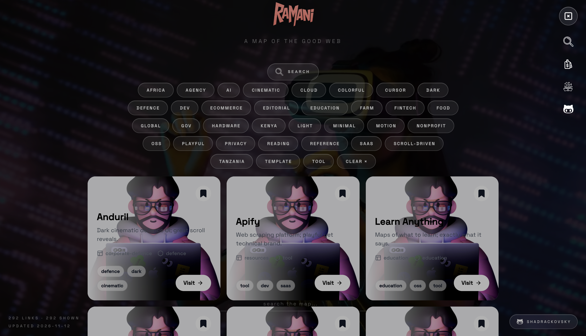

# ramani

# ramani is a map of the good web uis worth stealing from, tools worth keeping.

    

**292 links** · last updated 2026-11-12

> auto-generated from [`data/links.json`](data/links.json). edit that file, not this one.

# ⭐ start here

| site | why | tags |
|------|-----|------|
| [anduril](https://www.anduril.com/) | dark cinematic defence ui; great scroll reveals. | `defence` `dark` `cinematic` `motion` |
| [apify](https://apify.com/) | web scraping platform; playful yet technical brand. | `tool` `dev` `saas` `oss` |
| [learn anything](https://learn-anything.xyz) | maps of what to learn; exactly what it says. | `education` `oss` `tool` `minimal` |
| [palantir](https://www.palantir.com) | dark industrial data platform; the defence aesthetic to beat. | `defence` `dark` `ai` `saas` |
| [porsche racing](https://racing.porsche.com/?locale=en) | motorsport storytelling; cinematic scroll-driven pages. | `cinematic` `motion` `scroll-driven` `editorial` `dark` |
| [saaspo](https://saaspo.com) | saas design inspiration gallery; curation done well. | `reference` `saas` `minimal` `tool` |
| [the odin project](https://www.theodinproject.com/) | free full-stack curriculum; the gold standard path. | `education` `dev` `oss` |
| [untitled ui](https://www.untitledui.com/react/components) | best-in-class ui kit reference; every pattern solved. | `template` `reference` `minimal` `saas` |

## landing pages

| site | why | tags |
|------|-----|------|
| [ajazz store](https://ajazzstore.com/) | keyboard gear store; enthusiast hardware shop. | `ecommerce` `hardware` |
| [antaira](https://www.antaira.com/) | industrial networking gear; engineering-spec landing. | `hardware` `global` |
| [barrick gold](https://www.barrick.com/English/home/default.aspx) | gold miner corporate; investor-grade storytelling. | `global` `editorial` |
| [beak & skiff](https://beakandskiff.com/) | apple orchard brand; warm seasonal marketing. | `food` `light` `minimal` |
| [cape union mart](https://www.capeunionmart.co.za/) | sa outdoor chain; solid retail merchandising. | `ecommerce` `africa` |
| [coco wyo](https://cocowyo.com/) | cozy coloring brand; gentle, playful commerce. | `playful` `ecommerce` `colorful` |
| [codiste](https://www.codiste.com) | dev agency landing; clear services storytelling. | `agency` `ai` `dev` |
| [cofounder](https://cofounder.co/) | startup product pitch; confident, minimal type. | `minimal` `saas` |
| [general intelligence company](https://www.generalintelligencecompany.com/) | ai outfit; sharp, modern product landing. | `ai` `minimal` `global` |
| [getmyboat](https://www.getmyboat.com/) | boat rental marketplace; map-first browsing done well. | `ecommerce` `global` |
| [glovo](https://glovoapp.com/en) | delivery app marketing; energetic color-blocked sections. | `food` `ecommerce` `colorful` `global` |
| [ikea](https://www.ikea.com/) | retail giant; product and wayfinding patterns worth study. | `ecommerce` `global` `light` |
| [kpmg](https://kpmg.com/xx/en.html) | big four global; sober professional identity at scale. | `global` `editorial` |
| [mall of the emirates](https://www.malloftheemirates.com/en) | mall site; store directories and wayfinding patterns. | `ecommerce` `global` |
| [micron](https://www.micron.com/) | memory chip maker; precise engineering corporate site. | `hardware` `global` |
| [nékter juice bar](https://www.nekterjuicebar.com/) | juice bar chain; fresh, colorful franchise marketing. | `food` `colorful` `playful` |
| [pingo ai](https://pingo.ai/) | ai product; clean, modern pitch page. | `ai` `saas` |
| [porsche racing](https://racing.porsche.com/?locale=en) | motorsport storytelling; cinematic scroll-driven pages. | `cinematic` `motion` `scroll-driven` `editorial` `dark` |
| [realtor.ca](https://www.realtor.ca/) | canadian listings; map-driven search ux reference. | `ecommerce` `global` |
| [rocket](https://www.rocket.new/) | ai app builder; bold launch-style landing. | `ai` `saas` `tool` |
| [sequoia capital](https://sequoiacap.com/) | vc site with editorial calm; type-driven pages. | `editorial` `minimal` `fintech` |
| [teguar](https://teguar.com/) | industrial computers; spec-driven hardware catalogue. | `hardware` `global` |
| [trappers](https://www.trappers.co.za/) | south african outdoor retailer; rugged catalogue pages. | `ecommerce` `africa` |
| [uber eats](https://www.ubereats.com/) | delivery giant; appetite-first commerce patterns. | `food` `ecommerce` `colorful` `global` |
| [walmart](https://www.walmart.com/) | commerce at scale; checkout and listing patterns. | `ecommerce` `global` |
| [webflow](https://webflow.com/) | no-code builder; the marketing bar for saas sites. | `saas` `tool` `dev` `motion` |
| [yango](https://yango.com/) | ride and delivery superapp; bold global brand pages. | `global` `playful` |

## saas dashboards

| site | why | tags |
|------|-----|------|
| [3cx](https://www.3cx.com/) | self-hosted pbx; utilitarian software marketing. | `saas` `tool` `dev` |
| [abacus ai](https://abacus.ai/) | enterprise ai platform; dense but confident. | `ai` `saas` |
| [adalat ai](https://www.adalat.ai/) | ai for legal systems; mission-led startup page. | `ai` `saas` |
| [base44](https://base44.com/) | ai app builder; colorful vibecoding energy. | `ai` `saas` `playful` |
| [bayesian health](https://www.bayesianhealth.com/) | clinical ai; trustworthy healthcare enterprise pages. | `ai` `saas` |
| [braintrust](https://www.braintrust.dev/) | ai eval platform; developer-grade design. | `ai` `dev` `saas` |
| [c3 ai](https://c3.ai/) | enterprise ai suite; dense but polished b2b. | `ai` `saas` |
| [calendly](https://calendly.com/) | scheduling standard; frictionless onboarding flows. | `saas` `tool` `minimal` |
| [cartesia](https://www.cartesia.ai/) | voice ai models; sleek research-flavored landing. | `ai` `saas` `dev` |
| [cerebras](https://www.cerebras.ai/) | wafer-scale ai compute; bold technical branding. | `ai` `hardware` `saas` |
| [cloudflare](https://www.cloudflare.com/) | internet infrastructure; the reference for scale. | `cloud` `dev` `saas` `global` |
| [cobit solutions](https://cobit-solutions.com/en) | business software vendor; practical b2b pages. | `saas` `tool` `dev` |
| [context](https://www.context.dev/) | dev tool; lean, terminal-flavored landing. | `dev` `ai` `saas` |
| [cortical labs](https://corticallabs.com/) | biological computers; wild frontier research story. | `ai` `hardware` |
| [deepnote](https://deepnote.com/) | data notebooks; collaborative, polished product tour. | `saas` `dev` `tool` |
| [domyn](https://www.domyn.com/) | ai company; sleek enterprise positioning. | `ai` `saas` |
| [fly.io](https://fly.io/) | infra marketing with actual taste; docs-like vibe. | `dev` `cloud` `saas` `dark` |
| [gusto](https://gusto.com/) | payroll and hr; friendly, human saas marketing. | `saas` `fintech` `playful` `light` |
| [helpware](https://helpware.com/) | outsourced support; polished bpo marketing. | `saas` `agency` |
| [hubspot](https://www.hubspot.com/) | marketing suite; orange brand done at scale. | `saas` `colorful` `playful` `global` |
| [ideogram](https://ideogram.ai/) | image generation that actually nails typography. | `ai` `saas` `playful` |
| [kilo](https://kilo.ai/) | ai coding platform; agent marketplace energy. | `ai` `dev` `saas` |
| [kimi code](https://www.kimi.com/code/en) | kimi's coding agent; clean dev-facing landing. | `ai` `dev` `saas` |
| [meetkai](https://meetkai.com/) | conversational ai; friendly product tour. | `ai` `saas` |
| [mindcloud](https://mindcloud.co/) | integration platform; tidy b2b pitch. | `saas` `tool` `dev` |
| [minimax](https://www.minimax.io/) | chinese ai lab; slick global product pages. | `ai` `saas` `global` |
| [miro](https://miro.com/) | collaboration canvas; friendly colorful saas marketing. | `saas` `tool` `colorful` `playful` |
| [odoo](https://www.odoo.com/) | open erp suite; clean modular product pages. | `saas` `oss` `tool` |
| [openai codex](https://openai.com/codex/) | openai's coding agent; big-lab product polish. | `ai` `dev` `saas` |
| [planetscale](https://planetscale.com/) | serverless mysql; crisp developer infra brand. | `saas` `dev` `cloud` |
| [poolside](https://poolside.ai) | ai code models; sleek dark landing. | `ai` `dark` `saas` |
| [power bi consulting services](https://powerbiconsultingservices.com/) | bi consultancy; niche services, dashboards focus. | `saas` `agency` `tool` |
| [primefold](https://primefold.ai/) | ai tool; compact modern launch page. | `ai` `saas` |
| [protopie](https://www.protopie.io/) | prototyping tool; motion-first product story. | `tool` `motion` `saas` |
| [qwen](https://qwen.ai/home) | alibaba's open models; research-brand landing. | `ai` `saas` `global` |
| [rezi](https://www.rezi.ai/) | ai resume builder; sharp conversion-focused pages. | `ai` `tool` `saas` |
| [robin ai](https://robinai.com/) | legal ai copilot; confident enterprise pitch. | `ai` `saas` |
| [samsara](https://www.samsara.com/) | fleet iot platform; crisp enterprise saas site. | `saas` `hardware` |
| [sarvam ai](https://www.sarvam.ai/) | india-first ai models; confident research brand. | `ai` `saas` `global` |
| [scaleway](https://www.scaleway.com/en/) | french cloud; playful violet infra marketing. | `cloud` `saas` `dev` |
| [sentry](https://sentry.io/welcome/) | error tracking; great developer dx branding. | `dev` `saas` `tool` |
| [supportyourapp](https://supportyourapp.com/) | support-as-a-service; bold, loud agency branding. | `saas` `agency` |
| [toonbee](https://toonbee.ai/) | ai cartoon maker; playful toy-like landing. | `ai` `playful` `saas` |
| [valoris](https://www.valoris.ro/) | romanian bpo; clean corporate services presence. | `agency` `global` |
| [virtual sales](https://www.virtual-sales.com/) | virtual sales outsourcing; legacy b2b presence. | `saas` `agency` |
| [voiceflow](https://www.voiceflow.com/) | conversational agent builder; clean chat-first ux. | `ai` `saas` `tool` |
| [world labs](https://www.worldlabs.ai/) | spatial ai lab; research-forward landing. | `ai` `saas` `global` |
| [z code](https://zcode.z.ai/en) | z.ai coding product; glm-powered ide play. | `ai` `dev` `saas` |
| [zoho](https://www.zoho.com/) | app suite empire; sprawling but consistent branding. | `saas` `tool` `global` |
| [zoominfo](https://zoominfo.com/) | b2b data platform; assertive enterprise sales site. | `saas` `tool` `global` |

## fintech

| site | why | tags |
|------|-----|------|
| [akoya](https://akoya.com/) | financial data network; understated b2b design. | `fintech` `saas` `dev` |
| [atfinity](https://www.atfinity.swiss/) | swiss regtech; calm, rule-based compliance ui. | `fintech` `saas` `minimal` |
| [bank of america](https://www.bankofamerica.com/) | mega-bank; study the scale and accessibility. | `fintech` `global` |
| [breet](https://breet.io/) | crypto-to-cash for africa; clean swap flows. | `fintech` `africa` `saas` |
| [cardtonic](https://cardtonic.com/) | gift card trading; bright african fintech brand. | `fintech` `africa` `ecommerce` |
| [dpo group](https://dpogroup.com/) | african payment gateway; practical merchant pages. | `fintech` `africa` `saas` |
| [envestnet](https://www.envestnet.com/) | wealth-tech platform; corporate but refined. | `fintech` `saas` `global` |
| [firstbase](https://www.firstbase.io/) | company formation and banking; crisp founder onboarding. | `fintech` `saas` `minimal` |
| [flinks](https://www.flinks.com/) | open banking data; enterprise api pages. | `fintech` `saas` `dev` |
| [j.p. morgan](https://www.jpmorgan.com/global) | banking giant; dense, disciplined finance ui. | `fintech` `global` |
| [mercury](https://mercury.com/) | startup banking; the calm, precise fintech look. | `fintech` `saas` `minimal` |
| [method](https://methodfi.com/) | debt repayment api; clean modern fintech pitch. | `fintech` `saas` `dev` |
| [mx](https://www.mx.com/) | financial data platform; quiet enterprise polish. | `fintech` `saas` `dev` |
| [nmb bank](https://www.nmbbank.co.tz/) | tanzania's bank; practical everyday banking ui. | `fintech` `tanzania` `africa` |
| [plaid](https://plaid.com/en-gb/) | bank api standard; developer-first finance design. | `fintech` `saas` `dev` |
| [relay](https://relayfi.com/) | business banking; friendly, clear money ui. | `fintech` `saas` `minimal` |
| [selcom developers](https://developers.selcommobile.com/#introduction) | tanzanian payment api docs; local fintech in the open. | `fintech` `tanzania` `dev` `africa` |
| [smile id](https://smile.id/) | african identity verification; bold, confident brand. | `fintech` `africa` `saas` |
| [stripe](https://stripe.com/) | the reference for developer-first finance design. | `fintech` `saas` `dev` `minimal` |
| [stripe financial connections](https://stripe.com/financial-connections) | bank-linking product; great feature page anatomy. | `fintech` `saas` `dev` |
| [teller](https://teller.io/) | bank api startup; sparse, precise developer story. | `fintech` `dev` `minimal` |
| [truelayer](https://truelayer.com/) | open banking apis; bold, confident fintech brand. | `fintech` `saas` `dev` |
| [yodlee](https://www.yodlee.com/) | og data aggregation; enterprise finance veteran. | `fintech` `saas` `global` |

## corporate defence

| site | why | tags |
|------|-----|------|
| [anduril](https://www.anduril.com/) | dark cinematic defence ui; great scroll reveals. | `defence` `dark` `cinematic` `motion` |
| [exida](https://www.exida.com/) | functional safety firm; dense spec-heavy corporate site. | `hardware` `reference` |
| [iacp](https://www.theiacp.org/) | police leadership association; formal institutional site. | `gov` `defence` `global` |
| [lockheed martin](https://www.lockheedmartin.com/) | classic defence contractor; structured and serious. | `defence` `gov` |
| [palantir](https://www.palantir.com) | dark industrial data platform; the defence aesthetic to beat. | `defence` `dark` `ai` `saas` |
| [rtx](https://www.rtx.com/) | aerospace defence giant; clean engineering grids. | `defence` `gov` `global` |

## agriculture farms

| site | why | tags |
|------|-----|------|
| [access agriculture](https://www.accessagriculture.org/) | farmer training videos; practical global-south resource. | `farm` `nonprofit` `africa` `education` |
| [bee worthy farms](https://www.beeworthyfarms.com/) | bee farm brand; warm local produce story. | `farm` `food` `playful` |
| [bloom ranch of acton](https://bloomranchofacton.com/) | ranch shop; sunny produce-driven commerce. | `farm` `food` `colorful` |
| [deck family farm](https://www.deckfamilyfarm.com/) | regenerative family farm; honest pastoral layout. | `farm` `food` `editorial` |
| [edenmoor](https://www.edenmoor.com/) | farm estate; calm pastoral branding. | `farm` `minimal` |
| [farm africa](https://www.farmafrica.org/) | agri ngo; credible field programs, clear comms. | `farm` `nonprofit` `africa` |
| [great lakes farms](https://www.greatlakesfarms.ca/) | orchard farm; cheerful apple-season marketing. | `farm` `food` `playful` |
| [magicland farms](https://www.magiclandfarms.com/) | family farm market; friendly seasonal info. | `farm` `food` `playful` |
| [positively grown](https://www.positivelygrownllc.com/) | small grower; simple, sincere farm page. | `farm` `food` `minimal` |
| [pure land organic](https://www.purelandorganic.com/) | organic farm; earthy, straightforward offering. | `farm` `food` |
| [soul food farm](https://www.soulfoodfarm.com/) | family farm; rustic personal storytelling. | `farm` `food` `editorial` |
| [winter spring csa](https://www.winterspringcsa.com/) | csa farm; honest seasonal simplicity. | `farm` `food` `minimal` |
| [winter spring farm on csa coalition](https://www.csacoalition.org/farms/winterspring-farm) | farm directory listing; how csas get discovered. | `farm` `reference` |
| [woodstock farm sanctuary](https://woodstocksanctuary.org/) | farm sanctuary; compassionate, story-led design. | `farm` `nonprofit` `editorial` |

## food beverage

| site | why | tags |
|------|-----|------|
| [burn stoves](https://www.burnstoves.com/) | clean cookstoves; mission-driven product pages. | `food` `africa` `minimal` |
| [concept catering](https://www.concept-catering.de/) | german caterers; refined event presentation. | `food` `minimal` `editorial` |
| [gg catering](https://www.ggcatering.com/) | catering service; appetizing event galleries. | `food` `editorial` |
| [juice press](https://www.juicepress.com/) | juice brand; loud, confident retail energy. | `food` `colorful` `playful` |
| [nourish cold pressed](https://nourishcoldpressed.com/) | cold-pressed juice; clean wellness branding. | `food` `minimal` |
| [pedals](https://drinkpedals.com/) | non-dairy milk; bright fun packaging site. | `food` `playful` `colorful` |
| [the little sicilian](https://thelittlesicilian.net/) | family pizzeria; warm, homely menu site. | `food` `playful` |

## education

| site | why | tags |
|------|-----|------|
| [ai advent calendar](https://ai-advent-calendar.replit.app/lesson/models) | bite-size ai lessons; friendly advent format. | `ai` `education` `dev` |
| [building multimodal data pipelines](https://www.deeplearning.ai/courses/building-multimodal-data-pipelines) | multimodal pipelines course; practical short format. | `ai` `education` `dev` |
| [fawe tanzania](https://fawetanzania.or.tz/) | girls' education ngo; mission-driven local chapter. | `tanzania` `nonprofit` `education` `africa` |
| [fe training](https://www.fe.training/) | financial engineering training; deep structured learning. | `education` `fintech` `reference` |
| [handong global university](https://www.handong.edu/eng/) | korean university portal; tidy academic layout. | `education` `global` |
| [harvard business publishing](https://hbsp.harvard.edu/) | harvard case studies; serious academic storefront. | `education` `reference` `global` |
| [iced book](https://book.iced.rs/) | iced gui book; rust ui in chaptered docs. | `dev` `oss` `education` `reference` |
| [learn anything](https://learn-anything.xyz) | maps of what to learn; exactly what it says. | `education` `oss` `tool` `minimal` |
| [learn anything: django](https://learn-anything.xyz/django) | django path; structured learning graph. | `education` `dev` `reference` |
| [learning rust](https://learning-rust.github.io/) | rust from scratch; gentle structured chapters. | `dev` `education` `reference` |
| [learning rust labs](https://learning-rust.github.io/labs/building-a-containerized-restful-api/) | containerized rust api lab; hands-on walkthrough. | `dev` `education` `reference` |
| [middlesex university](https://www.mdx.ac.uk/) | london university; solid course marketing. | `education` `global` |
| [skillshare](https://www.skillshare.com/en/) | creative classes; friendly course marketplace. | `education` `playful` `global` |
| [the odin project](https://www.theodinproject.com/) | free full-stack curriculum; the gold standard path. | `education` `dev` `oss` |
| [the rust book](https://doc.rust-lang.org/book/) | the canonical free rust text. | `dev` `oss` `education` `reference` |
| [todai weblab](https://weblab.t.u-tokyo.ac.jp/en/) | tokyo web lab; academic but sharp portfolio. | `education` `dev` |
| [wat english](https://www.wojsko-polskie.pl/wat/en/) | polish military tech academy; institutional english page. | `education` `gov` `defence` |
| [west point](https://www.westpoint.edu/) | us military academy; disciplined institutional design. | `education` `gov` `defence` |
| [youth employment uk](https://www.youthemployment.org.uk/) | youth careers nonprofit; friendly, clear guidance. | `nonprofit` `education` |

## portfolios creative

| site | why | tags |
|------|-----|------|
| [and walsh](https://andwalsh.com/) | design studio; bold, colorful identity work. | `agency` `colorful` `editorial` |
| [artcraft](https://getartcraft.com/) | studio portfolio; crafted case-study layouts. | `agency` `colorful` `playful` |
| [colin.day](https://colin.day/) | personal site; tiny, sharp, ownable. | `minimal` `dev` |
| [dagi natsuko: deveaux](https://daginatsuko.com/content/photos/deveaux) | artist photo series; moody editorial layout. | `editorial` `playful` |
| [facet interactive](https://facetinteractive.com/) | interactive studio; refined case-study design. | `agency` `minimal` `editorial` |
| [future processing](https://www.future-processing.com/) | software house; enterprise-grade agency site. | `agency` `dev` `global` |
| [hey clicky](https://www.heyclicky.com/) | little interactive toy; cursor and click delight. | `playful` `cursor` |
| [lance alexander](https://www.lance-alexander.net/) | recruitment firm; clean executive branding. | `agency` `minimal` |
| [luke combs](https://www.lukecombs.com/) | country star site; tour-first music marketing. | `editorial` `playful` |
| [mirko.in.ua](https://mirko.in.ua/) | personal dev page; small and direct. | `minimal` `dev` |
| [morgan wallen](https://morganwallen.com/home/) | artist site; bold tour and merch push. | `editorial` `global` |
| [neal.fun](https://neal.fun/) | web toys done right; endless playful experiments. | `playful` `dev` `colorful` |
| [pinnacle consulting group](https://pinnacleconsultingroup.co.ke/) | kenyan consultancy; straightforward corporate identity. | `kenya` `africa` `agency` |
| [reenbit](https://reenbit.com/) | software house; modern studio landing. | `agency` `dev` |
| [sabertooth marketing](https://sabertoothmarketing.co.ke/) | kenyan marketing agency; bold local branding. | `agency` `kenya` `africa` |
| [serhant.](https://serhant.com) | real estate as showbiz; loud cinematic listings. | `editorial` `motion` `colorful` |
| [six feet up](https://sixfeetup.com/) | python dev shop; confident, colorful agency site. | `agency` `dev` |
| [the web kitchen](https://www.thewebkitchen.co.uk/) | uk studio; restrained, typographic agency site. | `agency` `minimal` `editorial` |
| [toolbox creative](https://toolboxcreative.com/) | creative agency; bold work showcase. | `agency` `colorful` |
| [wavemaker by the web kitchen](https://www.thewebkitchen.co.uk/web-design/wavemaker/) | case study; nice scroll-driven work. | `agency` `motion` `scroll-driven` `editorial` |
| [Innocent Masuki](https://innocentmasuki.me/) | software engineer from Dar es Salaam, Tanzania, with expertise in front-end development (React, React Native, Swift, Kotlin), TypeScript, and various technologies. Currently working at Jigsol Applied Intelligence in London. | `developer` `portfolio` `frontend` `tanzania` `software-engineer` |
| [shadrackovsky](https://zuck30.github.io/zuck30) | AI/ML & Software Engineer from Tanzania, obsessed with Chinese open-source AI (DeepSeek, Qwen, etc.). Builds web applications, ML systems, RAG pipelines, and has pre-trained Swahili-GPT. Self-taught with a focus on Chinese AI tools. | `ai` `ml` `software-engineer` `portfolio` `tanzania` `chinese-ai` `open-source` |

## local tanzania

| site | why | tags |
|------|-----|------|
| [antera](https://antera.co.tz) | tanzanian firm; clean corporate presence. | `tanzania` `africa` |
| [azzaman tanzania](https://azzaman.tz/) | tanzanian outfit; unclassified - revisit. | `tanzania` `reference` |
| [bahari web](https://bahariweb.com/) | tanzanian web studio; bold local portfolio. | `tanzania` `africa` `agency` |
| [bonga](https://bonga.co.tz/) | tanzanian platform; one to watch. | `tanzania` `africa` |
| [bongasms](https://bongasms.com/) | tanzanian sms gateway; simple messaging api. | `tanzania` `dev` `africa` |
| [datamanics](https://datamanics.co.tz/) | dar data and software shop; practical services. | `tanzania` `dev` `africa` |
| [deloitte tanzania](https://www.deloitte.com/tz/en.html) | big four, local lens; polished advisory pages. | `tanzania` `africa` `global` |
| [eacop](https://www.eacop.com/) | pipeline project; corporate infrastructure comms. | `tanzania` `africa` |
| [flashnet exotel](https://flashnet.co.tz/exotel/) | tanzanian network firm reselling cloud telephony. | `tanzania` `cloud` `africa` |
| [habari](https://www.habari.co.tz/) | tanzanian telecom group; corporate but local. | `tanzania` `africa` |
| [ifs consulting](https://ifsconsulting.co.tz/) | dar consulting firm; straightforward corporate pages. | `tanzania` `africa` |
| [immigration passport services](https://eservices.immigration.go.tz/online/web/passport) | passport application portal; government forms flow. | `tanzania` `gov` `africa` |
| [manka](https://manka.tz/) | tanzanian brand; promising local site. | `tanzania` `africa` |
| [marie stopes tanzania](https://www.mariestopes.or.tz/) | health nonprofit; warm, accessible local site. | `tanzania` `nonprofit` `africa` |
| [netpoa](https://netpoa.com/) | dar isp; direct packages and pricing. | `tanzania` `africa` |
| [nhif self service](https://selfservice.nhif.or.tz/home) | government self-service portal; practical forms. | `tanzania` `gov` `africa` |
| [nilipe](https://nilipe.co.tz/) | swahili-named payments play; watch this space. | `tanzania` `africa` `fintech` |
| [pi tech](https://pitech.co.tz/) | dar-based it firm; no-frills services layout. | `tanzania` `dev` `africa` |
| [platinum credit](https://platinumcredit.co.tz/) | east african microloans; direct service pages. | `fintech` `tanzania` `africa` |
| [pmbet](https://pmbet.co.tz/sw/home) | swahili betting portal; quick local flows. | `tanzania` `africa` `playful` |
| [power computers](https://powercomputers.co.tz/) | local tech retailer; dense product catalogue. | `tanzania` `hardware` `ecommerce` `africa` |
| [restova](https://www.restova.co.tz/) | tanzanian brand; promising local product. | `tanzania` `africa` |
| [sido](https://www.sido.go.tz/) | small-industry support; useful local programs. | `tanzania` `gov` `africa` |
| [tanzajob](https://www.tanzajob.com/) | local job board; functional listing ux. | `tanzania` `africa` `tool` |
| [tanzania bureau of standards](https://www.tbs.go.tz/) | standards bureau; institutional and formal. | `tanzania` `gov` `africa` |
| [tausi](https://tausi.tamisemi.go.tz) | government jobs portal; dense but functional. | `tanzania` `gov` `africa` |
| [utel](https://utel.co.tz/) | tanzanian isp; straightforward telecom services. | `tanzania` `africa` |
| [vf tanzania](https://www.vftz.co.tz/) | tanzanian outfit; unclassified - revisit. | `tanzania` `reference` |
| [wazo host](https://wazohost.co.tz/) | tanzanian hosting; no-frills local infrastructure. | `tanzania` `dev` `africa` |
| [wazoefu](https://www.wazoefu.com/) | tanzanian business; worth a closer look. | `tanzania` `africa` |

## resources

| site | why | tags |
|------|-----|------|
| [1001 fonts](https://www.1001fonts.com/) | free font archive; old-school but useful. | `reference` `tool` `global` |
| [302.ai](https://302.ai/) | pay-as-you-go ai toolbox; utilitarian aggregator. | `ai` `cloud` `dev` `saas` |
| [99designs](https://99designs.com/) | design marketplace; crowdsourcing at scale. | `tool` `global` `ecommerce` |
| [afl-cio](https://aflcio.org/) | labor federation; solid civic storytelling. | `nonprofit` `reference` `global` |
| [apify](https://apify.com/) | web scraping platform; playful yet technical brand. | `tool` `dev` `saas` `oss` |
| [apitemplate.io](https://apitemplate.io/) | document templating api; niche tool done simply. | `tool` `saas` `dev` |
| [appflowy](https://appflowy.com/) | open notion alternative; clean productivity tool. | `oss` `tool` `dev` `minimal` |
| [bear blog](https://bearblog.dev/) | minimal blogging; radical lightness done right. | `oss` `minimal` `dev` `tool` `privacy` |
| [cal.com](https://cal.com/) | open scheduling; calendly's open rival, well branded. | `oss` `tool` `dev` `minimal` |
| [cap](https://cap.so/) | open screen recorder; friendly indie product. | `oss` `tool` `minimal` `dev` |
| [charm](https://charm.land/) | terminal tooling with taste; tuis as brand. | `dev` `oss` `tool` `playful` |
| [conductor](https://www.conductor.build/) | claude code manager; tidy multi-agent ui. | `ai` `dev` `tool` |
| [cosmic](https://system76.com/cosmic) | system76's rust desktop; bold open de design. | `oss` `dev` `hardware` |
| [crabnebula](https://crabnebula.dev/) | rust and dx tooling company; sharp open-source branding. | `oss` `dev` `tool` |
| [daytona](https://www.daytona.io/) | dev environments; fast, dark infra marketing. | `dev` `cloud` `oss` `tool` |
| [deepinfra](https://deepinfra.com/) | model inference api; plain, cheap, developer-first. | `ai` `dev` `cloud` |
| [e2b](https://e2b.dev/) | sandboxes for ai agents; hacker-flavored infra. | `dev` `ai` `oss` `cloud` |
| [egui](https://www.egui.rs/) | immediate-mode gui in rust; fast to ship. | `dev` `oss` `tool` |
| [eleutherai](https://www.eleuther.ai) | open-source ai research collective; plain and honest. | `ai` `oss` `dev` |
| [encode ai](https://encodeai.org/) | ai policy org; advocacy with clean civic design. | `ai` `nonprofit` `reference` |
| [ente](https://ente.com/) | end-to-end encrypted photos; privacy with polish. | `privacy` `oss` `minimal` `tool` |
| [fandom](https://www.fandom.com/) | wiki empire; massive community knowledge base. | `reference` `global` `playful` |
| [flexjobs](https://www.flexjobs.com/) | remote job board; functional and calm. | `reference` `tool` `global` |
| [free3d](https://free3d.com/) | free 3d model archive; useful asset source. | `tool` `reference` `global` |
| [google ai studio](https://aistudio.google.com/welcome) | playground for gemini; fastest way to test prompts. | `ai` `tool` `dev` `global` |
| [google labs](https://labs.google/) | google's experiments hub; playful product grid. | `ai` `global` `playful` |
| [gpui kit](https://gpui-kit.com/) | zed's gpui components; native ui kit for rust. | `dev` `oss` `tool` `minimal` |
| [icann](https://www.icann.org/en) | internet governance body; dry but authoritative. | `gov` `reference` `global` |
| [iced](https://iced.rs/) | rust gui library; elm-inspired and tidy. | `dev` `oss` `tool` |
| [inference.net](https://inference.net/) | gpu inference provider; straightforward dev pricing. | `ai` `cloud` `dev` `saas` |
| [jikan](https://jikan.moe/) | unofficial myanimelist api; clean open data. | `dev` `oss` `reference` |
| [justsketchme](https://justsketch.me/) | poseable figure tool; handy for artists. | `tool` `playful` `dev` |
| [kilo cli](https://kilo.ai/cli) | kilo's cli; agents in the terminal. | `ai` `dev` `tool` |
| [kobotoolbox](https://www.kobotoolbox.org/) | field data collection toolkit; humanitarian and free. | `tool` `nonprofit` `oss` `reference` |
| [land-book](https://land-book.com/) | landing page gallery; curated design references. | `reference` `minimal` `tool` |
| [liners](https://liners.com/) | ai reading assistant; highlight-and-summarize tool. | `ai` `tool` `saas` |
| [lummi](https://www.lummi.ai/) | ai stock image library; generous and fast. | `ai` `tool` |
| [macports ports](https://ports.macports.org/) | package browser; utilitarian dev reference. | `dev` `oss` `reference` `tool` |
| [made in webflow: agriculture](https://webflow.com/made-in-webflow/agriculture) | curated farm sites built in webflow. | `reference` `farm` `tool` |
| [nixos](https://nixos.org/) | reproducible os; docs-driven, principled site. | `oss` `dev` `reference` `minimal` |
| [nvchad](https://nvchad.com/) | neovim config; fast, beautiful terminal setup. | `dev` `oss` `minimal` `tool` `dark` |
| [onorca](https://www.onorca.dev/) | agent orchestration workspace; promising dev tool. | `dev` `ai` `tool` |
| [open source pledge](https://opensourcepledge.com/) | funding pledge for oss; simple, principled page. | `oss` `reference` `minimal` |
| [opencode](https://opencode.ai/) | open coding agent; the terminal ai workhorse. | `ai` `dev` `oss` `tool` |
| [pico css](https://picocss.com/) | classless css framework; minimalism as a feature. | `dev` `oss` `minimal` `tool` |
| [pinetools: invert colors](https://pinetools.com/invert-image-colors) | tiny online utilities; utilitarian tool pages. | `tool` `reference` |
| [porkbun](https://porkbun.com/) | domain registrar with a playful, distinct brand. | `tool` `playful` `dev` |
| [pygments](https://pygments.org/) | syntax highlighter; workhorse of code colors. | `dev` `oss` `reference` `tool` |
| [quasar](https://quasar.dev/) | vue framework; thorough docs and component kit. | `dev` `oss` `tool` |
| [reflex](https://reflex.dev/) | pure-python web apps; framework done cleanly. | `dev` `oss` `tool` |
| [relay evals](https://relayevals.com/) | llm eval tooling; pragmatic testing reference. | `ai` `dev` `tool` `reference` |
| [saaspo](https://saaspo.com) | saas design inspiration gallery; curation done well. | `reference` `saas` `minimal` `tool` |
| [slint](https://slint.dev/) | rust and embedded ui toolkit; declarative and lean. | `dev` `oss` `tool` |
| [sniffnet](https://sniffnet.app/) | rust network monitor; gorgeous open-source gui. | `oss` `dev` `tool` |
| [sphinx](https://sphinx-doc.org/en/master/index.html) | docs generator; quietly powers half the ecosystem. | `dev` `oss` `reference` `tool` |
| [strawberry browser](https://strawberrybrowser.com/) | indie browser; fresh take on browsing tools. | `tool` `dev` `playful` |
| [streamline](https://home.streamlinehq.com/) | icon and illustration sets; fast design resources. | `tool` `reference` `dev` |
| [t3 code](https://t3.codes/) | open ai code editor; terminal-first tooling. | `ai` `dev` `tool` |
| [tailadmin](https://tailadmin.com/) | free tailwind dashboard templates; handy starting kit. | `template` `saas` `tool` `dev` |
| [traccar](https://www.traccar.org/) | open gps tracking platform; honest docs-first site. | `oss` `tool` `reference` `dev` |
| [tvmaze](https://www.tvmaze.com/) | tv database and api; no-nonsense data reference. | `reference` `tool` `global` |
| [unkey](https://www.unkey.com/) | api infra; dark, fast, developer-credible. | `dev` `oss` `tool` `dark` |
| [untitled ui](https://www.untitledui.com/react/components) | best-in-class ui kit reference; every pattern solved. | `template` `reference` `minimal` `saas` |
| [yahoo! japan](https://www.yahoo.co.jp/) | japanese portal; dense info hierarchy worth studying. | `global` `colorful` |
| [zod](https://zod.dev/) | typescript schema validation; tiny, essential, beloved. | `dev` `oss` `tool` `minimal` |

## reading

| site | why | tags |
|------|-----|------|
| [aap](https://www.aap.ph/) | unclassified - revisit. | `reference` |
| [adec kenya](https://www.adec-kenya.com/) | unclassified - revisit. | `reference` |
| [ageimmune](https://ageimmune.com/) | unclassified - revisit. | `reference` |
| [altalogy](https://www.altalogy.com/) | unclassified - revisit. | `reference` |
| [axum](https://axum.earth/) | unclassified - revisit. | `reference` |
| [byg advantage](https://www.bygadvantage.com/) | unclassified - revisit. | `reference` |
| [deepseek harness](https://www.deepseek.com/en/harness/) | deepseek agent harness writeup; technical reading. | `ai` `dev` |
| [earendil](https://earendil.com/) | unclassified - revisit. | `reference` |
| [fair](https://fair.io/) | unclassified - revisit. | `reference` |
| [flint](https://www.flint.com/) | unclassified - revisit. | `reference` |
| [gci world 2026 student guide](https://curved-rambutan-a71.notion.site/GCI-World-2026-September-Student-Guide-971cfa7cece78245925781c15c64559b) | student guide doc; keep for reference. | `education` `reference` |
| [hugo](https://hugoinc.com/) | unclassified - revisit. | `reference` |
| [lucumr](https://lucumr.pocoo.org/) | armin ronacher's blog; essential longform on software. | `dev` `editorial` `oss` |
| [mental models](https://mentalmodels.co/) | mental models reference; clear thinking tool. | `reference` `reading` |
| [nela healthcare](https://nelahealthcare.com/) | unclassified - revisit. | `reference` |
| [pontem innovations](https://www.ponteminnovations.ca/) | unclassified - revisit. | `reference` |
| [radish](https://www.myradish.com/) | unclassified - revisit. | `reference` |
| [rustify](https://rustify.rs/) | unclassified - revisit. | `reference` |
| [sensiq](https://sensiq.co/) | unclassified - revisit. | `reference` |
| [shared drive folder](https://drive.google.com/drive/folders/14cuJTWCwVaVJ3yaxUMExBY0dCkZFwMXj) | shared folder; contents unclassified - revisit. | `reference` |
| [siren](https://siren.io/) | unclassified - revisit. | `reference` |
| [slate demo](https://demo.slate-app.online/app/demo) | unclassified - revisit. | `reference` |
| [spark x2.5 heretic](https://ollama.com/maternion/spark-x2.5-heretic) | uncensored model experiment on ollama; worth a poke. | `ai` `dev` `oss` |
| [technobrain group](https://www.technobraingroup.com/) | unclassified - revisit. | `reference` |
| [tekateki studios](https://www.tekatekistudios.com/) | unclassified - revisit. | `reference` |
| [the drop times](https://www.thedroptimes.com/) | web and dev news outlet; daily industry pulse. | `editorial` `dev` |
| [untitled figma file](https://www.figma.com/design/zuCrG2w3959zW2lWhojHge/Untitled?node-id=0-1) | own figma canvas; working reference file. | `tool` `reference` |
| [ved-net](https://www.ved-net.com/en/) | unclassified - revisit. | `reference` |
| [vidi corp](https://vidi-corp.com/) | unclassified - revisit. | `reference` |
| [world labs: atlas](https://www.worldlabs.ai/blog/atlas) | spatial ai writeup; worth a slow read. | `ai` `reading` |
| [you could have trained the kimi k1.5](https://morluto.bearblog.dev/you-could-have-trained-the-kimi-k1-5/) | essay on training kimi; worth the read. | `ai` `reading` |