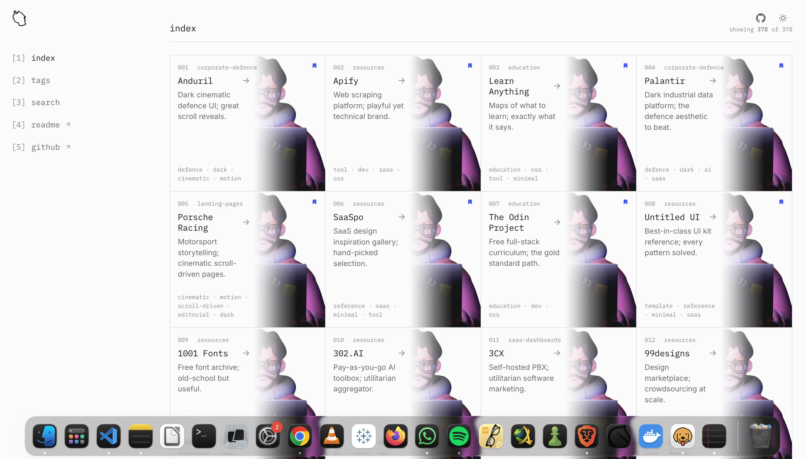

# ramani

a curated map of the good web: landing pages, saas dashboards, fintech, portfolios, developer tools, and african/tanzanian sites worth learning from.

**website:** [https://zuck30.github.io/ramani/](https://zuck30.github.io/ramani/) · [browse by tags](https://zuck30.github.io/ramani/tags/)

    

**373 links** · last updated 2026-11-18

> auto-generated from [`data/links.json`](data/links.json). edit that file, not this one.

# ⭐ start here

| Site | Why | Tags |
|------|-----|------|
| [Anduril](https://www.anduril.com/) | Dark cinematic defence UI; great scroll reveals. | `defence` `dark` `cinematic` `motion`|
| [Apify](https://apify.com/) | Web scraping platform; playful yet technical brand. | `tool` `dev` `saas` `oss`|
| [Learn Anything](https://learn-anything.xyz) | Maps of what to learn; exactly what it says. | `education` `oss` `tool` `minimal`|
| [Palantir](https://www.palantir.com) | Dark industrial data platform; the defence aesthetic to beat. | `defence` `dark` `ai` `saas`|
| [Porsche Racing](https://racing.porsche.com/?locale=en) | Motorsport storytelling; cinematic scroll-driven pages. | `cinematic` `motion` `scroll-driven` `editorial` `dark`|
| [SaaSpo](https://saaspo.com) | SaaS design inspiration gallery; curation done well. | `reference` `saas` `minimal` `tool`|
| [The Odin Project](https://www.theodinproject.com/) | Free full-stack curriculum; the gold standard path. | `education` `dev` `oss`|
| [Untitled UI](https://www.untitledui.com/react/components) | Best-in-class UI kit reference; every pattern solved. | `template` `reference` `minimal` `saas`|

## landing pages

| Site | Why | Tags |
|------|-----|------|
| [Ajazz Store](https://ajazzstore.com/) | Keyboard gear store; enthusiast hardware shop. | `ecommerce` `hardware`|
| [Antaira](https://www.antaira.com/) | Industrial networking gear; engineering-spec landing. | `hardware` `global`|
| [Barrick Gold](https://www.barrick.com/English/home/default.aspx) | Gold miner corporate; investor-grade storytelling. | `global` `editorial`|
| [Beak & Skiff](https://beakandskiff.com/) | Apple orchard brand; warm seasonal marketing. | `food` `light` `minimal`|
| [Cape Union Mart](https://www.capeunionmart.co.za/) | SA outdoor chain; solid retail merchandising. | `ecommerce` `africa`|
| [Coco Wyo](https://cocowyo.com/) | Cozy coloring brand; gentle, playful commerce. | `playful` `ecommerce` `colorful`|
| [Codiste](https://www.codiste.com) | Dev agency landing; clear services storytelling. | `agency` `ai` `dev`|
| [Cofounder](https://cofounder.co/) | Startup product pitch; confident, minimal type. | `minimal` `saas`|
| [General Intelligence Company](https://www.generalintelligencecompany.com/) | AI outfit; sharp, modern product landing. | `ai` `minimal` `global`|
| [GetMyBoat](https://www.getmyboat.com/) | Boat rental marketplace; map-first browsing done well. | `ecommerce` `global`|
| [Glovo](https://glovoapp.com/en) | Delivery app marketing; energetic color-blocked sections. | `food` `ecommerce` `colorful` `global`|
| [IKEA](https://www.ikea.com/) | Retail giant; product and wayfinding patterns worth study. | `ecommerce` `global` `light`|
| [Inter Miami CF](https://www.intermiamicf.com/) | Official club site with news, roster, schedule, tickets, and fan content for Inter Miami CF. | `sports` `global` `media`|
| [Jenga](https://www.jenga.com/index.php) | Official Jenga site; classic block-stacking game brand with products, videos, and shop links. | `playful` `global`|
| [KPMG](https://kpmg.com/xx/en.html) | Big Four global; sober professional identity at scale. | `global` `editorial`|
| [Logitech G](https://www.logitechg.com/) | Gaming gear brand site; product lineup and category merchandising for mice, keyboards, and racing setups. | `hardware` `ecommerce` `gaming` `global`|
| [Mall of the Emirates](https://www.malloftheemirates.com/en) | Mall site; store directories and wayfinding patterns. | `ecommerce` `global`|
| [Micron](https://www.micron.com/) | Memory chip maker; precise engineering corporate site. | `hardware` `global`|
| [Nékter Juice Bar](https://www.nekterjuicebar.com/) | Juice bar chain; fresh, colorful franchise marketing. | `food` `colorful` `playful`|
| [Pingo AI](https://pingo.ai/) | AI product; clean, modern pitch page. | `ai` `saas`|
| [Porsche Racing](https://racing.porsche.com/?locale=en) | Motorsport storytelling; cinematic scroll-driven pages. | `cinematic` `motion` `scroll-driven` `editorial` `dark`|
| [Realtor.ca](https://www.realtor.ca/) | Canadian listings; map-driven search UX reference. | `ecommerce` `global`|
| [Rocket](https://www.rocket.new/) | AI app builder; bold launch-style landing. | `ai` `saas` `tool`|
| [Sequoia Capital](https://sequoiacap.com/) | VC site with editorial calm; type-driven pages. | `editorial` `minimal` `fintech`|
| [Teguar](https://teguar.com/) | Industrial computers; spec-driven hardware catalogue. | `hardware` `global`|
| [Trappers](https://www.trappers.co.za/) | South African outdoor retailer; rugged catalogue pages. | `ecommerce` `africa`|
| [Uber Eats](https://www.ubereats.com/) | Delivery giant; appetite-first commerce patterns. | `food` `ecommerce` `colorful` `global`|
| [Walmart](https://www.walmart.com/) | Commerce at scale; checkout and listing patterns. | `ecommerce` `global`|
| [Webflow](https://webflow.com/) | No-code builder; the marketing bar for SaaS sites. | `saas` `tool` `dev` `motion`|
| [Xiaomi Africa](https://www.mi.com/africa-en/) | Xiaomi's Africa site; phones, wearables, and smart devices showcase. | `hardware` `ecommerce` `africa` `global`|
| [Yango](https://yango.com/) | Ride and delivery superapp; bold global brand pages. | `global` `playful`|

## saas dashboards

| Site | Why | Tags |
|------|-----|------|
| [3CX](https://www.3cx.com/) | Self-hosted PBX; utilitarian software marketing. | `saas` `tool` `dev`|
| [Abacus AI](https://abacus.ai/) | Enterprise AI platform; dense but confident. | `ai` `saas`|
| [Adalat AI](https://www.adalat.ai/) | AI for legal systems; mission-led startup page. | `ai` `saas`|
| [Arize AI](https://arize.com/) | Agent observability and evaluation platform; trace, eval, and improve AI systems. | `ai` `saas` `dev` `tool`|
| [Base44](https://base44.com/) | AI app builder; colorful vibecoding energy. | `ai` `saas` `playful`|
| [Bayesian Health](https://www.bayesianhealth.com/) | Clinical AI; trustworthy healthcare enterprise pages. | `ai` `saas`|
| [Braintrust](https://www.braintrust.dev/) | AI eval platform; developer-grade design. | `ai` `dev` `saas`|
| [C3 AI](https://c3.ai/) | Enterprise AI suite; dense but polished B2B. | `ai` `saas`|
| [Calendly](https://calendly.com/) | Scheduling standard; frictionless onboarding flows. | `saas` `tool` `minimal`|
| [Cartesia](https://www.cartesia.ai/) | Voice AI models; sleek research-flavored landing. | `ai` `saas` `dev`|
| [Cerebras](https://www.cerebras.ai/) | Wafer-scale AI compute; bold technical branding. | `ai` `hardware` `saas`|
| [Cloudflare](https://www.cloudflare.com/) | Internet infrastructure; the reference for scale. | `cloud` `dev` `saas` `global`|
| [Cobit Solutions](https://cobit-solutions.com/en) | Business software vendor; practical B2B pages. | `saas` `tool` `dev`|
| [Context](https://www.context.dev/) | Dev tool; lean, terminal-flavored landing. | `dev` `ai` `saas`|
| [Cortical Labs](https://corticallabs.com/) | Biological computers; wild frontier research story. | `ai` `hardware`|
| [Deepnote](https://deepnote.com/) | Data notebooks; collaborative, polished product tour. | `saas` `dev` `tool`|
| [Domyn](https://www.domyn.com/) | AI company; sleek enterprise positioning. | `ai` `saas`|
| [Fly.io](https://fly.io/) | Infra marketing with actual taste; docs-like vibe. | `dev` `cloud` `saas` `dark`|
| [Gusto](https://gusto.com/) | Payroll and HR; friendly, human SaaS marketing. | `saas` `fintech` `playful` `light`|
| [Helpware](https://helpware.com/) | Outsourced support; polished BPO marketing. | `saas` `agency`|
| [HiO](https://hio.ai/) | AI business partner for small businesses; handles messages, marketing, and insights. | `ai` `saas` `tool`|
| [HubSpot](https://www.hubspot.com/) | Marketing suite; orange brand done at scale. | `saas` `colorful` `playful` `global`|
| [Ideogram](https://ideogram.ai/) | Image generation that actually nails typography. | `ai` `saas` `playful`|
| [Kilo](https://kilo.ai/) | AI coding platform; agent marketplace energy. | `ai` `dev` `saas`|
| [Kimi Code](https://www.kimi.com/code/en) | Kimi's coding agent; clean dev-facing landing. | `ai` `dev` `saas`|
| [MeetKai](https://meetkai.com/) | Conversational AI; friendly product tour. | `ai` `saas`|
| [MindCloud](https://mindcloud.co/) | Integration platform; tidy B2B pitch. | `saas` `tool` `dev`|
| [MiniMax](https://www.minimax.io/) | Chinese AI lab; slick global product pages. | `ai` `saas` `global`|
| [Miro](https://miro.com/) | Collaboration canvas; friendly colorful SaaS marketing. | `saas` `tool` `colorful` `playful`|
| [Mistral AI](https://mistral.ai/) | Frontier AI company; model, cloud, and enterprise product pages with strong technical branding. | `ai` `saas` `dev` `global`|
| [Odoo](https://www.odoo.com/) | Open ERP suite; clean modular product pages. | `saas` `oss` `tool`|
| [OpenAI Codex](https://openai.com/codex/) | OpenAI's coding agent; big-lab product polish. | `ai` `dev` `saas`|
| [Pawa AI](https://pawa-ai.com/) | AI for African languages and voices; chat, agents, and builder platform. | `ai` `saas` `dev` `africa`|
| [PlanetScale](https://planetscale.com/) | Serverless MySQL; crisp developer infra brand. | `saas` `dev` `cloud`|
| [Poolside](https://poolside.ai) | AI code models; sleek dark landing. | `ai` `dark` `saas`|
| [Power BI Consulting Services](https://powerbiconsultingservices.com/) | BI consultancy; niche services, dashboards focus. | `saas` `agency` `tool`|
| [Primefold](https://primefold.ai/) | AI tool; compact modern launch page. | `ai` `saas`|
| [ProtoPie](https://www.protopie.io/) | Prototyping tool; motion-first product story. | `tool` `motion` `saas`|
| [Qwen](https://qwen.ai/home) | Alibaba's open models; research-brand landing. | `ai` `saas` `global`|
| [Rezi](https://www.rezi.ai/) | AI resume builder; sharp conversion-focused pages. | `ai` `tool` `saas`|
| [Robin AI](https://robinai.com/) | Legal AI copilot; confident enterprise pitch. | `ai` `saas`|
| [Samsara](https://www.samsara.com/) | Fleet IoT platform; crisp enterprise SaaS site. | `saas` `hardware`|
| [Sarvam AI](https://www.sarvam.ai/) | India-first AI models; confident research brand. | `ai` `saas` `global`|
| [Scaleway](https://www.scaleway.com/en/) | French cloud; playful violet infra marketing. | `cloud` `saas` `dev`|
| [Sentry](https://sentry.io/welcome/) | Error tracking; great developer DX branding. | `dev` `saas` `tool`|
| [SupportYourApp](https://supportyourapp.com/) | Support-as-a-service; bold, loud agency branding. | `saas` `agency`|
| [Toonbee](https://toonbee.ai/) | AI cartoon maker; playful toy-like landing. | `ai` `playful` `saas`|
| [TrackingMore](https://www.trackingmore.com/) | Multi-carrier shipment tracking API and dashboard for ecommerce and logistics. | `saas` `dev` `tool` `global`|
| [Trae AI](https://www.trae.ai/) | AI coding assistant and IDE for building software faster. | `ai` `dev` `tool`|
| [Valoris](https://www.valoris.ro/) | Romanian BPO; clean corporate services presence. | `agency` `global`|
| [Virtual Sales](https://www.virtual-sales.com/) | Virtual sales outsourcing; legacy B2B presence. | `saas` `agency`|
| [Voiceflow](https://www.voiceflow.com/) | Conversational agent builder; clean chat-first UX. | `ai` `saas` `tool`|
| [World Labs](https://www.worldlabs.ai/) | Spatial AI lab; research-forward landing. | `ai` `saas` `global`|
| [Z Code](https://zcode.z.ai/en) | Z.ai coding product; GLM-powered IDE play. | `ai` `dev` `saas`|
| [Zoho](https://www.zoho.com/) | App suite empire; sprawling but consistent branding. | `saas` `tool` `global`|
| [ZoomInfo](https://zoominfo.com/) | B2B data platform; assertive enterprise sales site. | `saas` `tool` `global`|

## fintech

| Site | Why | Tags |
|------|-----|------|
| [Akoya](https://akoya.com/) | Financial data network; understated B2B design. | `fintech` `saas` `dev`|
| [Atfinity](https://www.atfinity.swiss/) | Swiss regtech; calm, rule-based compliance UI. | `fintech` `saas` `minimal`|
| [Bank of America](https://www.bankofamerica.com/) | Mega-bank; study the scale and accessibility. | `fintech` `global`|
| [Breet](https://breet.io/) | Crypto-to-cash for Africa; clean swap flows. | `fintech` `africa` `saas`|
| [Cardtonic](https://cardtonic.com/) | Gift card trading; bright African fintech brand. | `fintech` `africa` `ecommerce`|
| [DPO Group](https://dpogroup.com/) | African payment gateway; practical merchant pages. | `fintech` `africa` `saas`|
| [Envestnet](https://www.envestnet.com/) | Wealth-tech platform; corporate but refined. | `fintech` `saas` `global`|
| [Firstbase](https://www.firstbase.io/) | Company formation and banking; crisp founder onboarding. | `fintech` `saas` `minimal`|
| [Flinks](https://www.flinks.com/) | Open banking data; enterprise API pages. | `fintech` `saas` `dev`|
| [J.P. Morgan](https://www.jpmorgan.com/global) | Banking giant; dense, disciplined finance UI. | `fintech` `global`|
| [Mercury](https://mercury.com/) | Startup banking; the calm, precise fintech look. | `fintech` `saas` `minimal`|
| [Method](https://methodfi.com/) | Debt repayment API; clean modern fintech pitch. | `fintech` `saas` `dev`|
| [MX](https://www.mx.com/) | Financial data platform; quiet enterprise polish. | `fintech` `saas` `dev`|
| [NMB Bank](https://www.nmbbank.co.tz/) | Tanzania's bank; practical everyday banking UI. | `fintech` `tanzania` `africa`|
| [Plaid](https://plaid.com/en-gb/) | Bank API standard; developer-first finance design. | `fintech` `saas` `dev`|
| [Relay](https://relayfi.com/) | Business banking; friendly, clear money UI. | `fintech` `saas` `minimal`|
| [Selcom Developers](https://developers.selcommobile.com/#introduction) | Tanzanian payment API docs; local fintech in the open. | `fintech` `tanzania` `dev` `africa`|
| [Smile ID](https://smile.id/) | African identity verification; bold, confident brand. | `fintech` `africa` `saas`|
| [Stripe](https://stripe.com/) | The reference for developer-first finance design. | `fintech` `saas` `dev` `minimal`|
| [Stripe Financial Connections](https://stripe.com/financial-connections) | Bank-linking product; great feature page anatomy. | `fintech` `saas` `dev`|
| [Teller](https://teller.io/) | Bank API startup; sparse, precise developer story. | `fintech` `dev` `minimal`|
| [TrueLayer](https://truelayer.com/) | Open banking APIs; bold, confident fintech brand. | `fintech` `saas` `dev`|
| [Yodlee](https://www.yodlee.com/) | OG data aggregation; enterprise finance veteran. | `fintech` `saas` `global`|

## corporate defence

| Site | Why | Tags |
|------|-----|------|
| [Anduril](https://www.anduril.com/) | Dark cinematic defence UI; great scroll reveals. | `defence` `dark` `cinematic` `motion`|
| [exida](https://www.exida.com/) | Functional safety firm; dense spec-heavy corporate site. | `hardware` `reference`|
| [IACP](https://www.theiacp.org/) | Police leadership association; formal institutional site. | `gov` `defence` `global`|
| [Lockheed Martin](https://www.lockheedmartin.com/) | Classic defence contractor; structured and serious. | `defence` `gov`|
| [Palantir](https://www.palantir.com) | Dark industrial data platform; the defence aesthetic to beat. | `defence` `dark` `ai` `saas`|
| [RTX](https://www.rtx.com/) | Aerospace defence giant; clean engineering grids. | `defence` `gov` `global`|

## agriculture farms

| Site | Why | Tags |
|------|-----|------|
| [Access Agriculture](https://www.accessagriculture.org/) | Farmer training videos; practical global-south resource. | `farm` `nonprofit` `africa` `education`|
| [Bee Worthy Farms](https://www.beeworthyfarms.com/) | Bee farm brand; warm local produce story. | `farm` `food` `playful`|
| [Bloom Ranch of Acton](https://bloomranchofacton.com/) | Ranch shop; sunny produce-driven commerce. | `farm` `food` `colorful`|
| [Deck Family Farm](https://www.deckfamilyfarm.com/) | Regenerative family farm; honest pastoral layout. | `farm` `food` `editorial`|
| [Edenmoor](https://www.edenmoor.com/) | Farm estate; calm pastoral branding. | `farm` `minimal`|
| [Farm Africa](https://www.farmafrica.org/) | Agri NGO; credible field programs, clear comms. | `farm` `nonprofit` `africa`|
| [Great Lakes Farms](https://www.greatlakesfarms.ca/) | Orchard farm; cheerful apple-season marketing. | `farm` `food` `playful`|
| [Magicland Farms](https://www.magiclandfarms.com/) | Family farm market; friendly seasonal info. | `farm` `food` `playful`|
| [Positively Grown](https://www.positivelygrownllc.com/) | Small grower; simple, sincere farm page. | `farm` `food` `minimal`|
| [Pure Land Organic](https://www.purelandorganic.com/) | Organic farm; earthy, straightforward offering. | `farm` `food`|
| [Soul Food Farm](https://www.soulfoodfarm.com/) | Family farm; rustic personal storytelling. | `farm` `food` `editorial`|
| [Winter Spring CSA](https://www.winterspringcsa.com/) | CSA farm; honest seasonal simplicity. | `farm` `food` `minimal`|
| [Winter Spring Farm on CSA Coalition](https://www.csacoalition.org/farms/winterspring-farm) | Farm directory listing; how CSAs get discovered. | `farm` `reference`|
| [Woodstock Farm Sanctuary](https://woodstocksanctuary.org/) | Farm sanctuary; compassionate, story-led design. | `farm` `nonprofit` `editorial`|

## food beverage

| Site | Why | Tags |
|------|-----|------|
| [Burn Stoves](https://www.burnstoves.com/) | Clean cookstoves; mission-driven product pages. | `food` `africa` `minimal`|
| [Concept Catering](https://www.concept-catering.de/) | German caterers; refined event presentation. | `food` `minimal` `editorial`|
| [GG Catering](https://www.ggcatering.com/) | Catering service; appetizing event galleries. | `food` `editorial`|
| [Juice Press](https://www.juicepress.com/) | Juice brand; loud, confident retail energy. | `food` `colorful` `playful`|
| [Nourish Cold Pressed](https://nourishcoldpressed.com/) | Cold-pressed juice; clean wellness branding. | `food` `minimal`|
| [Pedals](https://drinkpedals.com/) | Non-dairy milk; bright fun packaging site. | `food` `playful` `colorful`|
| [The Little Sicilian](https://thelittlesicilian.net/) | Family pizzeria; warm, homely menu site. | `food` `playful`|

## education

| Site | Why | Tags |
|------|-----|------|
| [Academy of Art University](https://www.academyart.edu/) | Art and design university site showcasing creative programs, admissions, and student work. | `education` `design` `reference`|
| [Adelphi University](https://www.adelphi.edu/) | Private university site featuring academics, admissions, research, and campus resources. | `education` `reference`|
| [Agnes Scott College](https://www.agnesscott.edu/) | Women's liberal arts college site covering academics, admissions, and campus life in Atlanta. | `education` `reference`|
| [AI Advent Calendar](https://ai-advent-calendar.replit.app/lesson/models) | Bite-size AI lessons; friendly advent format. | `ai` `education` `dev`|
| [Air Force Institute of Technology](https://www.afit.edu/) | Graduate school and research institution for the U.S. Air and Space Forces with degree and research programs. | `education` `reference`|
| [Alabama State University](https://www.alasu.edu/) | Public HBCU site highlighting academics, admissions, student life, and research. | `education` `reference`|
| [Albertus Magnus College](https://www.albertus.edu/) | Catholic liberal arts college site for academics, admissions, and campus life in New Haven. | `education` `reference`|
| [Alfred State College](https://www.alfredstate.edu/) | SUNY college site focused on applied learning programs, admissions, and student life. | `education` `reference`|
| [Allen College](https://www.allencollege.edu/) | Healthcare-focused college site for nursing and health sciences programs and admissions. | `education` `health` `reference`|
| [Alverno College](https://www.alverno.edu/) | Women's college site highlighting ability-based education, programs, and admissions. | `education` `reference`|
| [Amberton University](https://amberton.edu/) | University site offering flexible, affordable degree programs for working adults. | `education` `reference`|
| [Aquinas College](https://www.aquinas.edu/) | Liberal arts college site in Grand Rapids covering academics, admissions, and student life. | `education` `reference`|
| [Building Multimodal Data Pipelines](https://www.deeplearning.ai/courses/building-multimodal-data-pipelines) | Multimodal pipelines course; practical short format. | `ai` `education` `dev`|
| [Caltech](https://www.caltech.edu/) | California Institute of Technology's site highlighting research, academics, news, and campus resources. | `education` `reference` `global`|
| [Chowan University](https://www.chowan.edu/) | Faith-centered university site in North Carolina with academics, admissions, and campus life. | `education` `reference`|
| [Clarke University](https://www.clarke.edu/) | Liberal arts university site in Dubuque featuring academics, admissions, and student life. | `education` `reference`|
| [Cleveland State University](https://www.csuohio.edu/) | Cleveland State University's main site for academics, admissions, research, and campus life. | `education` `reference` `global`|
| [CodeCrafters](https://codecrafters.io/) | Hands-on programming challenges to build Redis, Git, SQLite, and other systems from scratch in your own language. | `dev` `education` `tool`|
| [Columbia University](https://www.columbia.edu/) | Columbia University's main site covering academics, research, admissions, and campus news. | `education` `reference` `global`|
| [FAWE Tanzania](https://fawetanzania.or.tz/) | Girls' education NGO; mission-driven local chapter. | `tanzania` `nonprofit` `education` `africa`|
| [FE Training](https://www.fe.training/) | Financial engineering training; deep structured learning. | `education` `fintech` `reference`|
| [globalEDGE](https://globaledge.msu.edu/) | Michigan State’s international business knowledge hub with country insights, trade data, and learning resources. | `education` `reference` `global`|
| [Hack Frontend](https://www.hackfrontend.com/en) | Frontend interview prep platform with JavaScript, React, and TypeScript articles, coding problems, and flashcards. | `dev` `education` `tool`|
| [Handong Global University](https://www.handong.edu/eng/) | Korean university portal; tidy academic layout. | `education` `global`|
| [Harvard Business Publishing](https://hbsp.harvard.edu/) | Harvard case studies; serious academic storefront. | `education` `reference` `global`|
| [Harvard Business School](https://www.hbs.edu/) | Business school site covering programs, faculty research, insights, and alumni resources. | `education` `reference` `global`|
| [Harvard University](https://www.harvard.edu/) | Harvard's main site showcasing academics, research, campus life, and institutional storytelling. | `education` `reference` `global`|
| [Iced Book](https://book.iced.rs/) | Iced GUI book; Rust UI in chaptered docs. | `dev` `oss` `education` `reference`|
| [Learn Anything](https://learn-anything.xyz) | Maps of what to learn; exactly what it says. | `education` `oss` `tool` `minimal`|
| [Learn Anything: Django](https://learn-anything.xyz/django) | Django path; structured learning graph. | `education` `dev` `reference`|
| [Learning Rust](https://learning-rust.github.io/) | Rust from scratch; gentle structured chapters. | `dev` `education` `reference`|
| [Learning Rust Labs](https://learning-rust.github.io/labs/building-a-containerized-restful-api/) | Containerized Rust API lab; hands-on walkthrough. | `dev` `education` `reference`|
| [Maranatha Baptist University](https://www.mbu.edu/) | Christian university site covering academics, admissions, online programs, and campus life. | `education` `reference`|
| [MastersPortal](https://www.mastersportal.com/) | Search platform for comparing master's programs and universities worldwide. | `education` `tool` `reference` `global`|
| [McKnight Brain Institute](https://mbi.ufl.edu/) | University of Florida neuroscience institute site with research, training, and news. | `education` `reference` `health`|
| [MEST Africa](https://meltwater.org/) | Pan-African tech entrepreneurship training, incubation, and seed funding. | `education` `africa` `dev` `nonprofit`|
| [Middlesex University](https://www.mdx.ac.uk/) | London university; solid course marketing. | `education` `global`|
| [MIT](https://web.mit.edu/) | Massachusetts Institute of Technology's main site for academics, research, admissions, and campus life. | `education` `reference` `global`|
| [MusiQuest](https://app.musiquest.com/welcome) | Creative, game-like way to learn music online. | `education` `tool` `playful`|
| [NJIT](https://www.njit.edu/) | New Jersey Institute of Technology's site for STEM academics, research, admissions, and campus life. | `education` `reference` `global`|
| [Penn State](https://www.psu.edu/) | Pennsylvania State University's main site covering academics, admissions, research, and campus life. | `education` `reference` `global`|
| [Princeton University](https://www.princeton.edu/) | Princeton's main site featuring academics, research, admissions, and university news. | `education` `reference` `global`|
| [Shule Direct](https://www.shuledirect.co.tz/) | Tanzanian digital learning platform with curriculum-aligned content, revision tools, and resources for students and teachers. | `tanzania` `africa` `education` `edtech`|
| [Skillshare](https://www.skillshare.com/en/) | Creative classes; friendly course marketplace. | `education` `playful` `global`|
| [The Odin Project](https://www.theodinproject.com/) | Free full-stack curriculum; the gold standard path. | `education` `dev` `oss`|
| [The Rust Book](https://doc.rust-lang.org/book/) | The canonical free Rust text. | `dev` `oss` `education` `reference`|
| [Todai WebLab](https://weblab.t.u-tokyo.ac.jp/en/) | Tokyo web lab; academic but sharp portfolio. | `education` `dev`|
| [Ubongo](https://www.ubongo.org/) | Tanzania-founded edutainment organization creating research-led learning media for children across Africa. | `tanzania` `africa` `education` `nonprofit` `playful`|
| [University of Chicago](https://www.uchicago.edu/) | University of Chicago's site for academics, research, admissions, and campus life. | `education` `reference` `global`|
| [WAT English](https://www.wojsko-polskie.pl/wat/en/) | Polish military tech academy; institutional English page. | `education` `gov` `defence`|
| [West Point](https://www.westpoint.edu/) | US Military Academy; disciplined institutional design. | `education` `gov` `defence`|
| [Western Washington University](https://www.wwu.edu/) | Public university site in Bellingham with academics, admissions, and campus life. | `education` `reference`|
| [Westfield State University](https://www.westfield.ma.edu/) | Public university site in Massachusetts with academics, admissions, and campus resources. | `education` `reference`|
| [Wheaton College](https://wheatoncollege.edu/) | Private liberal arts college site in Massachusetts with academics, admissions, and campus life. | `education` `reference`|
| [Wheeling University](https://wheeling.edu/) | Catholic university site in West Virginia with academics, admissions, and student success. | `education` `reference`|
| [Whittier College](https://www.whittier.edu/) | Private liberal arts college site in California with academics and admissions. | `education` `reference`|
| [Wilson College](https://www.wilson.edu/) | Private college site in Pennsylvania with academics, admissions, and student resources. | `education` `reference`|
| [Winona State University](https://www.winona.edu/) | Public university site in Minnesota with academics, admissions, and campus life. | `education` `reference`|
| [Winston-Salem State University](https://www.wssu.edu/) | Historically Black public university site in North Carolina with academics and student life. | `education` `reference`|
| [Winthrop University](https://www.winthrop.edu/) | Public university site in South Carolina with academics, admissions, and campus resources. | `education` `reference`|
| [Wisconsin Lutheran College](https://www.wlc.edu/) | Christian liberal arts college site in Milwaukee with academics and admissions. | `education` `reference`|
| [Wittenberg University](https://www.wittenberg.edu/) | Liberal arts university site in Ohio with academics, admissions, and student experience. | `education` `reference`|
| [Wofford College](https://www.wofford.edu/) | Liberal arts college site in South Carolina with academics, admissions, and campus life. | `education` `reference`|
| [Woodbury University](https://woodbury.edu/) | Private university site in Southern California with design, architecture, and business programs. | `education` `reference`|
| [Worcester Polytechnic Institute](https://www.wpi.edu/) | STEM-focused university site in Massachusetts highlighting project-based learning and research. | `education` `reference`|
| [Xavier University](https://www.xavier.edu/) | Jesuit university site in Cincinnati with academics, admissions, and student life. | `education` `reference`|
| [Xavier University of Louisiana](https://www.xula.edu/) | Historically Black Catholic university site in New Orleans with academics and admissions. | `education` `reference`|
| [Yeshiva University](https://www.yu.edu/) | Private research university site in New York City with academics, admissions, and campus resources. | `education` `reference`|
| [York College of Pennsylvania](https://www.ycp.edu/) | Private college site in Pennsylvania featuring programs, admissions, and student experience. | `education` `reference`|
| [Young Harris College](https://www.yhc.edu/) | Private liberal arts college site in the North Georgia mountains with academics and admissions. | `education` `reference`|
| [Youngstown State University](https://ysu.edu/) | Public university site in Ohio with academics, admissions, research, and campus life. | `education` `reference`|
| [Youth Employment UK](https://www.youthemployment.org.uk/) | Youth careers nonprofit; friendly, clear guidance. | `nonprofit` `education`|

## portfolios creative

| Site | Why | Tags |
|------|-----|------|
| [AND Walsh](https://andwalsh.com/) | Design studio; bold, colorful identity work. | `agency` `colorful` `editorial`|
| [ArtCraft](https://getartcraft.com/) | Studio portfolio; crafted case-study layouts. | `agency` `colorful` `playful`|
| [colin.day](https://colin.day/) | Personal site; tiny, sharp, ownable. | `minimal` `dev`|
| [DAGINATSUKO](https://daginatsuko.com/) | Personal portfolio showcasing web projects, builds, VRChat worlds, hardware, and photography. | `portfolio` `dev` `editorial`|
| [Facet Interactive](https://facetinteractive.com/) | Interactive studio; refined case-study design. | `agency` `minimal` `editorial`|
| [Future Processing](https://www.future-processing.com/) | Software house; enterprise-grade agency site. | `agency` `dev` `global`|
| [hacker.works](https://hacker.works/) | Digital product and innovation studio building software, growth, and AI solutions for teams and ventures. | `agency` `dev` `global`|
| [Hey Clicky](https://www.heyclicky.com/) | Little interactive toy; cursor and click delight. | `playful` `cursor`|
| [Innocent Masuki](https://innocentmasuki.me/) | Software engineer from Dar es Salaam, Tanzania, with expertise in front-end development (React, React Native, Swift, Kotlin), TypeScript, and various technologies. Currently working at Jigsol Applied Intelligence in London. | `developer` `portfolio` `frontend` `tanzania` `software-engineer`|
| [Lance Alexander](https://www.lance-alexander.net/) | Recruitment firm; clean executive branding. | `agency` `minimal`|
| [Luke Combs](https://www.lukecombs.com/) | Country star site; tour-first music marketing. | `editorial` `playful`|
| [mirko.in.ua](https://mirko.in.ua/) | Personal dev page; small and direct. | `minimal` `dev`|
| [Morgan Wallen](https://morganwallen.com/home/) | Artist site; bold tour and merch push. | `editorial` `global`|
| [Neal.fun](https://neal.fun/) | Web toys done right; endless playful experiments. | `playful` `dev` `colorful`|
| [Pinnacle Consulting Group](https://pinnacleconsultingroup.co.ke/) | Kenyan consultancy; straightforward corporate identity. | `kenya` `africa` `agency`|
| [Reenbit](https://reenbit.com/) | Software house; modern studio landing. | `agency` `dev`|
| [Sabertooth Marketing](https://sabertoothmarketing.co.ke/) | Kenyan marketing agency; bold local branding. | `agency` `kenya` `africa`|
| [SERHANT.](https://serhant.com) | Real estate as showbiz; loud cinematic listings. | `editorial` `motion` `colorful`|
| [shadrackovsky](https://zuck30.github.io/zuck30) | AI/ML & Software Engineer from Tanzania, obsessed with Chinese open-source AI (DeepSeek, Qwen, etc.). Builds web applications, ML systems, RAG pipelines, and has pre-trained Swahili-GPT. Self-taught with a focus on Chinese AI tools. | `ai` `ml` `software-engineer` `portfolio` `tanzania` `chinese-ai` `open-source`|
| [Six Feet Up](https://sixfeetup.com/) | Python dev shop; confident, colorful agency site. | `agency` `dev`|
| [The Web Kitchen](https://www.thewebkitchen.co.uk/) | UK studio; restrained, typographic agency site. | `agency` `minimal` `editorial`|
| [Toolbox Creative](https://toolboxcreative.com/) | Creative agency; bold work showcase. | `agency` `colorful`|
| [Wavemaker by The Web Kitchen](https://www.thewebkitchen.co.uk/web-design/wavemaker/) | Case study; nice scroll-driven work. | `agency` `motion` `scroll-driven` `editorial`|

## local tanzania

| Site | Why | Tags |
|------|-----|------|
| [Air Tanzania](https://www.airtanzania.co.tz/) | National airline website for bookings, destinations, fleet, and travel information. | `tanzania` `africa` `travel` `global`|
| [Antera](https://antera.co.tz) | Tanzanian firm; clean corporate presence. | `tanzania` `africa`|
| [Azzaman Tanzania](https://azzaman.tz/) | Tanzanian outfit; unclassified - revisit. | `tanzania` `reference`|
| [Bahari Web](https://bahariweb.com/) | Tanzanian web studio; bold local portfolio. | `tanzania` `africa` `agency`|
| [Bonga](https://bonga.co.tz/) | Tanzanian platform; one to watch. | `tanzania` `africa`|
| [BongaSMS](https://bongasms.com/) | Tanzanian SMS gateway; simple messaging API. | `tanzania` `dev` `africa`|
| [BRELA](https://www.brela.go.tz/) | Tanzania’s Business Registrations and Licensing Agency; official portal for company, business, and IP services. | `tanzania` `gov` `africa` `reference`|
| [BRIQ](https://briq.tz/) | Tanzanian communications platform offering bulk SMS, SMS API, and OTP services for businesses. | `tanzania` `saas` `api` `communications`|
| [Chipsi Kitaa](https://chipsikitaa.com/) | WhatsApp-based chipsi ordering platform for customers and food vendors in Tanzania. | `tanzania` `africa` `food` `ecommerce`|
| [Datamanics](https://datamanics.co.tz/) | Dar data and software shop; practical services. | `tanzania` `dev` `africa`|
| [Deloitte Tanzania](https://www.deloitte.com/tz/en.html) | Big Four, local lens; polished advisory pages. | `tanzania` `africa` `global`|
| [EACOP](https://www.eacop.com/) | Pipeline project; corporate infrastructure comms. | `tanzania` `africa`|
| [Feza Schools](https://fezaschools.org/) | Tanzanian school network site spanning nursery to A-Level programs across multiple campuses. | `tanzania` `education` `africa`|
| [Flashnet Exotel](https://flashnet.co.tz/exotel/) | Tanzanian network firm reselling cloud telephony. | `tanzania` `cloud` `africa`|
| [FUNGUO Tanzania](https://funguo.org/) | Tanzania innovation programme funding and supporting startups and MSMEs. | `tanzania` `africa` `nonprofit`|
| [Habari](https://www.habari.co.tz/) | Tanzanian telecom group; corporate but local. | `tanzania` `africa`|
| [Hungry Lion Tanzania](https://hungrylion.co.tz/) | Fried chicken chain in Tanzania; menu, store finder, and bold fast-food branding. | `food` `ecommerce` `tanzania` `africa`|
| [Hype Interactive](https://hype.co.tz/) | Dar es Salaam studio for product strategy, UI/UX, and web/mobile builds for local and regional clients. | `tanzania` `africa` `agency` `dev`|
| [IFS Consulting](https://ifsconsulting.co.tz/) | Dar consulting firm; straightforward corporate pages. | `tanzania` `africa`|
| [Immigration Passport Services](https://eservices.immigration.go.tz/online/web/passport) | Passport application portal; government forms flow. | `tanzania` `gov` `africa`|
| [Ligi Kuu](https://ligikuu.co.tz/) | Tanzania Premier League Board; fixtures, results, and league news. | `tanzania` `africa` `sports`|
| [Manka](https://manka.tz/) | Tanzanian brand; promising local site. | `tanzania` `africa`|
| [Marie Stopes Tanzania](https://www.mariestopes.or.tz/) | Health nonprofit; warm, accessible local site. | `tanzania` `nonprofit` `africa`|
| [NetPoa](https://netpoa.com/) | Dar ISP; direct packages and pricing. | `tanzania` `africa`|
| [NHIF Self Service](https://selfservice.nhif.or.tz/home) | Government self-service portal; practical forms. | `tanzania` `gov` `africa`|
| [Nilipe](https://nilipe.co.tz/) | Swahili-named payments play; watch this space. | `tanzania` `africa` `fintech`|
| [PI Tech](https://pitech.co.tz/) | Dar-based IT firm; no-frills services layout. | `tanzania` `dev` `africa`|
| [Platinum Credit](https://platinumcredit.co.tz/) | East African microloans; direct service pages. | `fintech` `tanzania` `africa`|
| [PMBet](https://pmbet.co.tz/sw/home) | Swahili betting portal; quick local flows. | `tanzania` `africa` `playful`|
| [Power Computers](https://powercomputers.co.tz/) | Local tech retailer; dense product catalogue. | `tanzania` `hardware` `ecommerce` `africa`|
| [Restova](https://www.restova.co.tz/) | Tanzanian brand; promising local product. | `tanzania` `africa`|
| [SIDO](https://www.sido.go.tz/) | Small-industry support; useful local programs. | `tanzania` `gov` `africa`|
| [TanzaJob](https://www.tanzajob.com/) | Local job board; functional listing UX. | `tanzania` `africa` `tool`|
| [Tanzania Bureau of Standards](https://www.tbs.go.tz/) | Standards bureau; institutional and formal. | `tanzania` `gov` `africa`|
| [Tausi](https://tausi.tamisemi.go.tz) | Government jobs portal; dense but functional. | `tanzania` `gov` `africa`|
| [UTEL](https://utel.co.tz/) | Tanzanian ISP; straightforward telecom services. | `tanzania` `africa`|
| [VF Tanzania](https://www.vftz.co.tz/) | Tanzanian outfit; unclassified - revisit. | `tanzania` `reference`|
| [Wazo Host](https://wazohost.co.tz/) | Tanzanian hosting; no-frills local infrastructure. | `tanzania` `dev` `africa`|
| [Wazo Tanzania](https://www.wazotz.com/) | Tanzanian maker of teak furniture, toys, and prefab homes with a clean local brand site. | `tanzania` `ecommerce` `design` `africa`|
| [Wazoefu](https://www.wazoefu.com/) | Tanzanian business; worth a closer look. | `tanzania` `africa`|
| [Wezatek](https://www.wezatek.pro/) | Tanzanian digital product engineering company offering software development, UX design, and AI solutions. | `tanzania` `africa` `agency` `dev`|

## resources

| Site | Why | Tags |
|------|-----|------|
| [1001 Fonts](https://www.1001fonts.com/) | Free font archive; old-school but useful. | `reference` `tool` `global`|
| [302.AI](https://302.ai/) | Pay-as-you-go AI toolbox; utilitarian aggregator. | `ai` `cloud` `dev` `saas`|
| [99designs](https://99designs.com/) | Design marketplace; crowdsourcing at scale. | `tool` `global` `ecommerce`|
| [AFL-CIO](https://aflcio.org/) | Labor federation; solid civic storytelling. | `nonprofit` `reference` `global`|
| [Apify](https://apify.com/) | Web scraping platform; playful yet technical brand. | `tool` `dev` `saas` `oss`|
| [APITemplate.io](https://apitemplate.io/) | Document templating API; niche tool done simply. | `tool` `saas` `dev`|
| [AppFlowy](https://appflowy.com/) | Open Notion alternative; clean productivity tool. | `oss` `tool` `dev` `minimal`|
| [Bear Blog](https://bearblog.dev/) | Minimal blogging; radical lightness done right. | `oss` `minimal` `dev` `tool` `privacy`|
| [Cal.com](https://cal.com/) | Open scheduling; Calendly's open rival, well branded. | `oss` `tool` `dev` `minimal`|
| [Cap](https://cap.so/) | Open screen recorder; friendly indie product. | `oss` `tool` `minimal` `dev`|
| [Charm](https://charm.land/) | Terminal tooling with taste; TUIs as brand. | `dev` `oss` `tool` `playful`|
| [Conductor](https://www.conductor.build/) | Claude Code manager; tidy multi-agent UI. | `ai` `dev` `tool`|
| [COSMIC](https://system76.com/cosmic) | System76's Rust desktop; bold open DE design. | `oss` `dev` `hardware`|
| [CrabNebula](https://crabnebula.dev/) | Rust and DX tooling company; sharp open-source branding. | `oss` `dev` `tool`|
| [Daytona](https://www.daytona.io/) | Dev environments; fast, dark infra marketing. | `dev` `cloud` `oss` `tool`|
| [DeepInfra](https://deepinfra.com/) | Model inference API; plain, cheap, developer-first. | `ai` `dev` `cloud`|
| [develoPPP](https://www.developpp.de/en/) | German development partnership programme funding sustainable private-sector projects. | `global` `reference` `nonprofit`|
| [E2B](https://e2b.dev/) | Sandboxes for AI agents; hacker-flavored infra. | `dev` `ai` `oss` `cloud`|
| [egui](https://www.egui.rs/) | Immediate-mode GUI in Rust; fast to ship. | `dev` `oss` `tool`|
| [EleutherAI](https://www.eleuther.ai) | Open-source AI research collective; plain and honest. | `ai` `oss` `dev`|
| [Encode AI](https://encodeai.org/) | AI policy org; advocacy with clean civic design. | `ai` `nonprofit` `reference`|
| [Ente](https://ente.com/) | End-to-end encrypted photos; privacy with polish. | `privacy` `oss` `minimal` `tool`|
| [Fandom](https://www.fandom.com/) | Wiki empire; massive community knowledge base. | `reference` `global` `playful`|
| [FlexJobs](https://www.flexjobs.com/) | Remote job board; functional and calm. | `reference` `tool` `global`|
| [Free3D](https://free3d.com/) | Free 3D model archive; useful asset source. | `tool` `reference` `global`|
| [Google AI Studio](https://aistudio.google.com/welcome) | Playground for Gemini; fastest way to test prompts. | `ai` `tool` `dev` `global`|
| [Google Labs](https://labs.google/) | Google's experiments hub; playful product grid. | `ai` `global` `playful`|
| [GOV.UK](https://www.gov.uk/) | UK government services and information portal; benchmark for clear public digital design. | `reference` `global` `minimal`|
| [GPUI Kit](https://gpui-kit.com/) | Zed's GPUI components; native UI kit for Rust. | `dev` `oss` `tool` `minimal`|
| [ICANN](https://www.icann.org/en) | Internet governance body; dry but authoritative. | `gov` `reference` `global`|
| [Iced](https://iced.rs/) | Rust GUI library; Elm-inspired and tidy. | `dev` `oss` `tool`|
| [Inference.net](https://inference.net/) | GPU inference provider; straightforward dev pricing. | `ai` `cloud` `dev` `saas`|
| [Jikan](https://jikan.moe/) | Unofficial MyAnimeList API; clean open data. | `dev` `oss` `reference`|
| [JustSketchMe](https://justsketch.me/) | Poseable figure tool; handy for artists. | `tool` `playful` `dev`|
| [Kilo CLI](https://kilo.ai/cli) | Kilo's CLI; agents in the terminal. | `ai` `dev` `tool`|
| [KoboToolbox](https://www.kobotoolbox.org/) | Field data collection toolkit; humanitarian and free. | `tool` `nonprofit` `oss` `reference`|
| [Land-book](https://land-book.com/) | Landing page gallery; curated design references. | `reference` `minimal` `tool`|
| [Liners](https://liners.com/) | AI reading assistant; highlight-and-summarize tool. | `ai` `tool` `saas`|
| [Lummi](https://www.lummi.ai/) | AI stock image library; generous and fast. | `ai` `tool`|
| [MacPorts Ports](https://ports.macports.org/) | Package browser; utilitarian dev reference. | `dev` `oss` `reference` `tool`|
| [Made in Webflow: Agriculture](https://webflow.com/made-in-webflow/agriculture) | Curated farm sites built in Webflow. | `reference` `farm` `tool`|
| [NixOS](https://nixos.org/) | Reproducible OS; docs-driven, principled site. | `oss` `dev` `reference` `minimal`|
| [NvChad](https://nvchad.com/) | Neovim config; fast, beautiful terminal setup. | `dev` `oss` `minimal` `tool` `dark`|
| [OnOrca](https://www.onorca.dev/) | Agent orchestration workspace; promising dev tool. | `dev` `ai` `tool`|
| [Open Source Pledge](https://opensourcepledge.com/) | Funding pledge for OSS; simple, principled page. | `oss` `reference` `minimal`|
| [OpenCode](https://opencode.ai/) | Open coding agent; the terminal AI workhorse. | `ai` `dev` `oss` `tool`|
| [Pico CSS](https://picocss.com/) | Classless CSS framework; minimalism as a feature. | `dev` `oss` `minimal` `tool`|
| [PineTools: Invert Colors](https://pinetools.com/invert-image-colors) | Tiny online utilities; utilitarian tool pages. | `tool` `reference`|
| [Porkbun](https://porkbun.com/) | Domain registrar with a playful, distinct brand. | `tool` `playful` `dev`|
| [Pygments](https://pygments.org/) | Syntax highlighter; workhorse of code colors. | `dev` `oss` `reference` `tool`|
| [Quasar](https://quasar.dev/) | Vue framework; thorough docs and component kit. | `dev` `oss` `tool`|
| [Reflex](https://reflex.dev/) | Pure-Python web apps; framework done cleanly. | `dev` `oss` `tool`|
| [Relay Evals](https://relayevals.com/) | LLM eval tooling; pragmatic testing reference. | `ai` `dev` `tool` `reference`|
| [SaaSpo](https://saaspo.com) | SaaS design inspiration gallery; curation done well. | `reference` `saas` `minimal` `tool`|
| [Slint](https://slint.dev/) | Rust and embedded UI toolkit; declarative and lean. | `dev` `oss` `tool`|
| [Sniffnet](https://sniffnet.app/) | Rust network monitor; gorgeous open-source GUI. | `oss` `dev` `tool`|
| [Sphinx](https://sphinx-doc.org/en/master/index.html) | Docs generator; quietly powers half the ecosystem. | `dev` `oss` `reference` `tool`|
| [Start.me](https://start.me/) | Personal start page and bookmark manager for links, feeds, and tools. | `tool` `reference` `global`|
| [Strawberry Browser](https://strawberrybrowser.com/) | Indie browser; fresh take on browsing tools. | `tool` `dev` `playful`|
| [Streamline](https://home.streamlinehq.com/) | Icon and illustration sets; fast design resources. | `tool` `reference` `dev`|
| [T3 Code](https://t3.codes/) | Open AI code editor; terminal-first tooling. | `ai` `dev` `tool`|
| [TailAdmin](https://tailadmin.com/) | Free Tailwind dashboard templates; handy starting kit. | `template` `saas` `tool` `dev`|
| [Traccar](https://www.traccar.org/) | Open GPS tracking platform; honest docs-first site. | `oss` `tool` `reference` `dev`|
| [TVmaze](https://www.tvmaze.com/) | TV database and API; no-nonsense data reference. | `reference` `tool` `global`|
| [Unkey](https://www.unkey.com/) | API infra; dark, fast, developer-credible. | `dev` `oss` `tool` `dark`|
| [Untitled UI](https://www.untitledui.com/react/components) | Best-in-class UI kit reference; every pattern solved. | `template` `reference` `minimal` `saas`|
| [Yahoo! JAPAN](https://www.yahoo.co.jp/) | Japanese portal; dense info hierarchy worth studying. | `global` `colorful`|
| [Zod](https://zod.dev/) | TypeScript schema validation; tiny, essential, beloved. | `dev` `oss` `tool` `minimal`|

## reading

| Site | Why | Tags |
|------|-----|------|
| [AAP](https://www.aap.ph/) | unclassified - revisit. | `reference`|
| [ADEC Kenya](https://www.adec-kenya.com/) | unclassified - revisit. | `reference`|
| [AgeImmune](https://ageimmune.com/) | unclassified - revisit. | `reference`|
| [Altalogy](https://www.altalogy.com/) | unclassified - revisit. | `reference`|
| [Axum](https://axum.earth/) | unclassified - revisit. | `reference`|
| [BYG Advantage](https://www.bygadvantage.com/) | unclassified - revisit. | `reference`|
| [DeepSeek Harness](https://www.deepseek.com/en/harness/) | DeepSeek agent harness writeup; technical reading. | `ai` `dev`|
| [Earendil](https://earendil.com/) | unclassified - revisit. | `reference`|
| [Fair](https://fair.io/) | unclassified - revisit. | `reference`|
| [Flint](https://www.flint.com/) | unclassified - revisit. | `reference`|
| [GCI World 2026 Student Guide](https://curved-rambutan-a71.notion.site/GCI-World-2026-September-Student-Guide-971cfa7cece78245925781c15c64559b) | Student guide doc; keep for reference. | `education` `reference`|
| [Hugo](https://hugoinc.com/) | unclassified - revisit. | `reference`|
| [Lucumr](https://lucumr.pocoo.org/) | Armin Ronacher's blog; essential longform on software. | `dev` `editorial` `oss`|
| [MacRumors](https://www.macrumors.com/) | Apple news, rumors, and product coverage; long-running enthusiast pulse. | `editorial` `reference` `global`|
| [Mental Models](https://mentalmodels.co/) | Mental models reference; clear thinking tool. | `reference` `reading`|
| [Nela Healthcare](https://nelahealthcare.com/) | unclassified - revisit. | `reference`|
| [Pontem Innovations](https://www.ponteminnovations.ca/) | unclassified - revisit. | `reference`|
| [Radish](https://www.myradish.com/) | unclassified - revisit. | `reference`|
| [Rustify](https://rustify.rs/) | unclassified - revisit. | `reference`|
| [Sensiq](https://sensiq.co/) | unclassified - revisit. | `reference`|
| [Shared Drive Folder](https://drive.google.com/drive/folders/14cuJTWCwVaVJ3yaxUMExBY0dCkZFwMXj) | Shared folder; contents unclassified - revisit. | `reference`|
| [Siren](https://siren.io/) | unclassified - revisit. | `reference`|
| [Slate Demo](https://demo.slate-app.online/app/demo) | unclassified - revisit. | `reference`|
| [Spark X2.5 Heretic](https://ollama.com/maternion/spark-x2.5-heretic) | Uncensored model experiment on Ollama; worth a poke. | `ai` `dev` `oss`|
| [Technobrain Group](https://www.technobraingroup.com/) | unclassified - revisit. | `reference`|
| [Tekateki Studios](https://www.tekatekistudios.com/) | unclassified - revisit. | `reference`|
| [The Drop Times](https://www.thedroptimes.com/) | Web and dev news outlet; daily industry pulse. | `editorial` `dev`|
| [Untitled Figma File](https://www.figma.com/design/zuCrG2w3959zW2lWhojHge/Untitled?node-id=0-1) | Own Figma canvas; working reference file. | `tool` `reference`|
| [Ved-Net](https://www.ved-net.com/en/) | unclassified - revisit. | `reference`|
| [VIDI Corp](https://vidi-corp.com/) | unclassified - revisit. | `reference`|
| [World Labs: Atlas](https://www.worldlabs.ai/blog/atlas) | Spatial AI writeup; worth a slow read. | `ai` `reading`|
| [You Could Have Trained the Kimi K1.5](https://morluto.bearblog.dev/you-could-have-trained-the-kimi-k1-5/) | Essay on training Kimi; worth the read. | `ai` `reading`|
