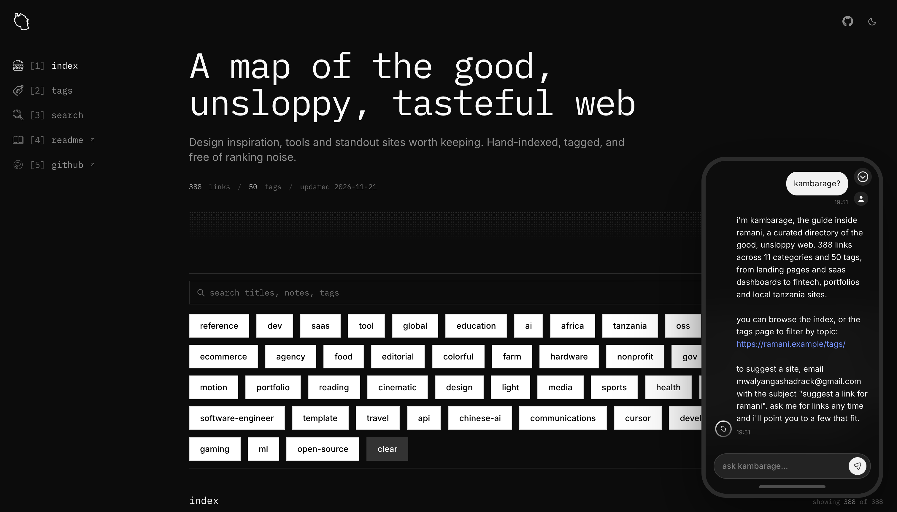
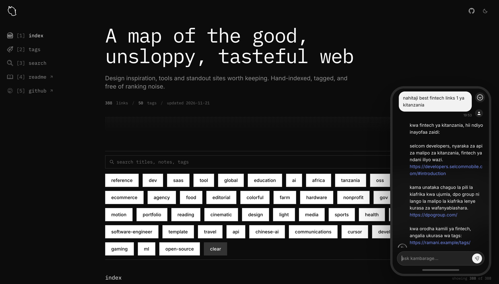
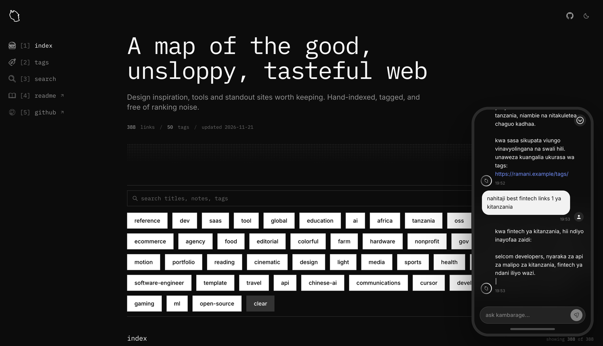

<div align="center">
  
  
  <br><br>
  <a href="https://zuck30.github.io/ramani/"></a>
  <a href="https://zuck30.github.io/ramani/"></a>
</div>

[](https://github.com/zuck30/ramani/actions/workflows/jekyll.yml)
[](https://zuck30.github.io/ramani/)
[](https://jekyllrb.com/)
[](https://www.ruby-lang.org/)
[](data/links.json)
[](mailto:mwalyangashadrack@gmail.com)
[](LICENSE)
[](CONTRIBUTION.md)

# a map of the good, unsloppy, tasteful web: landing pages, saas dashboards, fintech, portfolios, developer tools, and sites across global, africa and tanzania.

visit the [website](https://zuck30.github.io/ramani/) or browse the [tags](https://zuck30.github.io/ramani/tags/)

<p align="center">
  <a href="https://zuck30.github.io/ramani/">
    
  </a>
</p>

**401 links**, last updated 2026-11-21

> the link tables below are generated from [data/links.json](data/links.json). edit that file, not the tables.

see [coding style](CODINGSTYLE.md) for the design language and code conventions.

# getting started

ramani is a static [jekyll](https://jekyllrb.com/) site backed by a single json data file. there is no database, no api and no client-side framework: the browser only loads html, one stylesheet and a small vanilla-js search/filter script.

# why jekyll and ruby?

- **github pages builds it natively.** pushing to `main` runs jekyll in github actions and publishes the result, so hosting is free and requires no server.
- **liquid keeps content and layout separate.** `data/links.json` is the only place links live; the home page, tag page and readme are all rendered from it.
- **ruby is build-time only.** the language choice is about a mature static-site toolchain, not runtime dependencies. visitors download plain html, css and a few lines of javascript.
- **it stays small and fast.** no bundler, hydration, cdn runtime or database means fast loads and easy long-term maintenance.

# requirements

- ruby 3.0+ and bundler (`gem install bundler`). ruby 4 works through the included compatibility shim.
- node.js 20+, only needed to regenerate this readme.

# run it locally

```bash
bundle install
RUBYOPT="-r./scripts/ruby4-compat.rb" bundle exec jekyll serve --baseurl "" --port 4000
```

open **[localhost](http://localhost:4000)**: the development server runs on **port 4000** by default. `--baseurl ""` drops the production `/ramani` prefix so local asset urls resolve.

if jekyll stops with `cannot load such file -- webrick` (ruby 3+ no longer ships it), install it once:

```bash
gem install webrick
```

or build the site and serve the output with any static server:

```bash
RUBYOPT="-r./scripts/ruby4-compat.rb" bundle exec jekyll build --baseurl ""
python3 -m http.server 4000 --directory _site
```

# add a link

1. add an object to [data/links.json](data/links.json):

```json
{
  "url": "https://example.com",
  "title": "example",
  "why": "one line on what makes it worth keeping.",
  "tags": ["minimal", "saas"],
  "category": "landing-pages",
  "added": "2026-11-19",
  "favorite": false
}
```

2. regenerate the link tables in this readme:

```bash
node scripts/build-readme.js
```

3. commit both files and push to `main`. github actions builds and deploys the site automatically.

# project layout

<div align="center">

<table align="center">
  <thead>
    <tr><th>path</th><th>what it is</th></tr>
  </thead>
  <tbody>
    <tr><td><code>data/links.json</code></td><td>source of truth for every site, tag and note.</td></tr>
    <tr><td><code>index.html</code></td><td>home page: hero, search, tag filters and the link grid.</td></tr>
    <tr><td><code>tags.md</code></td><td>controlled tag vocabulary and live counts.</td></tr>
    <tr><td><code>_layouts/</code></td><td>jekyll layout (head, theme boot, page frame).</td></tr>
    <tr><td><code>_includes/</code></td><td>sidebar navigation and footer.</td></tr>
    <tr><td><code>assets/css/style.css</code></td><td>the opencode.ai-inspired design system.</td></tr>
    <tr><td><code>assets/for-card.png</code></td><td>mascot used as the card background.</td></tr>
    <tr><td><code>assets/nav-logo.png</code></td><td>navbar logo.</td></tr>
    <tr><td><code>assets/icons/</code></td><td>line icons for the sidebar navigation.</td></tr>
    <tr><td><code>assets/js/chat.js</code></td><td>the kambarage chat panel. vanilla js, no build step.</td></tr>
    <tr><td><code>feed.xml</code></td><td>atom feed of the 30 newest links.</td></tr>
    <tr><td><a href="supabase/README.md">supabase</a></td><td>the edge function that answers the chat panel.</td></tr>
    <tr><td><code>supabase/sql/rate-limit.sql</code></td><td>the shared rate limit table and function.</td></tr>
    <tr><td><a href="CODINGSTYLE.md">coding style</a></td><td>design language and code conventions.</td></tr>
    <tr><td><code>scripts/build-readme.js</code></td><td>rebuilds this readme from the json data.</td></tr>
    <tr><td><code>scripts/env.js</code></td><td>turns the gitignored .env into a local jekyll override.</td></tr>
    <tr><td><code>.env.example</code></td><td>the shape of .env, without the values.</td></tr>
    <tr><td><code>scripts/ruby4-compat.rb</code></td><td>local shim for jekyll 3.9 on ruby 4.</td></tr>
  </tbody>
</table>

</div>

# kambarage

the site has a small chat panel called kambarage in the bottom right corner. it recommends links from the map and answers questions about the project itself. the page ranks the links in the browser and sends only a handful of candidates to a supabase edge function, which holds the api key and calls the model. the widget stays hidden until `chat.endpoint` is set in `_config.yml`. see [supabase](supabase/README.md) for the deploy steps.

<div align="center">
  
  <br><br>
  
  <br><br>
  
</div>

# deployment

pushing to `main` triggers [.github/workflows/jekyll.yml](.github/workflows/jekyll.yml), which builds the site with `actions/jekyll-build-pages` and deploys it to github pages. the production base url is `/ramani`, matching `baseurl` in `_config.yml`.

# contributing

suggestions and new links are welcome. see [contribution](CONTRIBUTION.md) or open a pull request. please keep tags to the vocabulary listed on the [tags page](https://zuck30.github.io/ramani/tags/).

# credits

built with these, and grateful for them.

<p align="center">
  <a href="https://www.ruby-lang.org/"></a>
  &nbsp;&nbsp;&nbsp;
  <a href="https://jekyllrb.com/"></a>
  <a href="https://pages.github.com/"></a>
  &nbsp;&nbsp;&nbsp;
  <a href="https://supabase.com/"></a>
  &nbsp;&nbsp;&nbsp;
  <a href="https://www.deepseek.com/"></a>
  &nbsp;&nbsp;&nbsp;
  <a href="https://nodejs.org/"></a>
  &nbsp;&nbsp;
  <a href="https://inkscape.org/"></a>
  <a href="https://www.flaticon.com/"></a>
  &nbsp;&nbsp;
  <a href="https://opencode.ai/"></a>
</p>

- [jekyll](https://jekyllrb.com/) generates the site, with [kramdown](https://kramdown.gettalong.org/) for markdown and the [seo tag](https://github.com/jekyll/jekyll-seo-tag) and [sitemap](https://github.com/jekyll/jekyll-sitemap) plugins.
- [ruby](https://www.ruby-lang.org/) is the language underneath.
- [github pages](https://pages.github.com/) hosts the site and [github actions](https://github.com/features/actions) builds and deploys it.
- [ibm plex mono](https://www.ibm.com/plex/) and [inter](https://rsms.me/inter/) are the typefaces, served by [google fonts](https://fonts.google.com/).
- [flaticon](https://www.flaticon.com/) supplied the icons across the interface.
- [inkscape](https://inkscape.org/) drew the logo.
- [node.js](https://nodejs.org/) runs the small scripts that generate this readme and the local config.
- [supabase](https://supabase.com/) hosts the edge function behind the chat panel.
- [deepseek](https://www.deepseek.com/) is the model it calls.
- [shields.io](https://shields.io/) renders the badges at the top.

the interface takes its design language from [opencode](https://opencode.ai/).

# license

released under the [mit license](LICENSE).

beautifully made with love by [shadrackovsky](https://github.com/zuck30).

---

# start here

| site | why | tags |
|------|-----|------|
| [anduril](https://www.anduril.com/) | dark cinematic defence ui; great scroll reveals. | `defence` `dark` `cinematic` `motion` |
| [apify](https://apify.com/) | web scraping platform; playful yet technical brand. | `tool` `dev` `saas` `oss` |
| [learn anything](https://learn-anything.xyz) | maps of what to learn; exactly what it says. | `education` `oss` `tool` `minimal` |
| [palantir](https://www.palantir.com) | dark industrial data platform; the defence aesthetic to beat. | `defence` `dark` `ai` `saas` |
| [porsche racing](https://racing.porsche.com/?locale=en) | motorsport storytelling; cinematic scroll-driven pages. | `cinematic` `motion` `scroll-driven` `editorial` `dark` |
| [saaspo](https://saaspo.com) | saas design inspiration gallery; hand-picked selection. | `reference` `saas` `minimal` `tool` |
| [the odin project](https://www.theodinproject.com/) | free full-stack curriculum; the gold standard path. | `education` `dev` `oss` |
| [untitled ui](https://www.untitledui.com/react/components) | best-in-class ui kit reference; every pattern solved. | `template` `reference` `minimal` `saas` |

# landing pages

| site | why | tags |
|------|-----|------|
| [ajazz store](https://ajazzstore.com/) | keyboard gear store; enthusiast hardware shop. | `ecommerce` `hardware` |
| [antaira](https://www.antaira.com/) | industrial networking gear; engineering-spec landing. | `hardware` `global` |
| [barrick gold](https://www.barrick.com/English/home/default.aspx) | gold miner corporate; investor-grade storytelling. | `global` `editorial` |
| [beak & skiff](https://beakandskiff.com/) | apple orchard brand; warm seasonal marketing. | `food` `light` `minimal` |
| [cape union mart](https://www.capeunionmart.co.za/) | sa outdoor chain; solid retail merchandising. | `ecommerce` `africa` |
| [coco wyo](https://cocowyo.com/) | cozy coloring brand; gentle, playful commerce. | `playful` `ecommerce` `colorful` |
| [codiste](https://www.codiste.com) | dev agency landing; clear services storytelling. | `agency` `ai` `dev` |
| [cofounder](https://cofounder.co/) | startup product pitch; confident, minimal type. | `minimal` `saas` |
| [finn.no](https://www.finn.no/) | norwegian classifieds marketplace; dense listings with clear hierarchy. | `ecommerce` `global` `minimal` |
| [general intelligence company](https://www.generalintelligencecompany.com/) | ai outfit; sharp, modern product landing. | `ai` `minimal` `global` |
| [getmyboat](https://www.getmyboat.com/) | boat rental marketplace; map-first browsing done well. | `ecommerce` `global` |
| [glovo](https://glovoapp.com/en) | delivery app marketing; energetic color-blocked sections. | `food` `ecommerce` `colorful` `global` |
| [grovemade](https://grovemade.com/) | premium desk accessories and workspace goods; refined materials and minimal craft. | `ecommerce` `hardware` `minimal` `global` |
| [gumroad](https://gumroad.com/) | creator commerce platform; playful, confident marketing. | `ecommerce` `saas` `playful` `colorful` |
| [ikea](https://www.ikea.com/) | retail giant; product and wayfinding patterns worth study. | `ecommerce` `global` `light` |
| [inter miami cf](https://www.intermiamicf.com/) | official club site with news, roster, schedule, tickets, and fan content for inter miami cf. | `sports` `global` `media` |
| [jenga](https://www.jenga.com/index.php) | official jenga site; classic block-stacking game brand with products, videos, and shop links. | `playful` `global` |
| [kpmg](https://kpmg.com/xx/en.html) | big four global; sober professional identity at scale. | `global` `editorial` |
| [logitech g](https://www.logitechg.com/) | gaming gear brand site; product lineup and category merchandising for mice, keyboards, and racing setups. | `hardware` `ecommerce` `gaming` `global` |
| [mall of the emirates](https://www.malloftheemirates.com/en) | mall site; store directories and wayfinding patterns. | `ecommerce` `global` |
| [micron](https://www.micron.com/) | memory chip maker; precise engineering corporate site. | `hardware` `global` |
| [nékter juice bar](https://www.nekterjuicebar.com/) | juice bar chain; fresh, colorful franchise marketing. | `food` `colorful` `playful` |
| [palmeiras](https://palmeiras.com.br/) | brazilian football club; bold editorial matchday storytelling. | `sports` `global` `media` `editorial` |
| [pingo ai](https://pingo.ai/) | ai product; clean, modern pitch page. | `ai` `saas` |
| [porsche racing](https://racing.porsche.com/?locale=en) | motorsport storytelling; cinematic scroll-driven pages. | `cinematic` `motion` `scroll-driven` `editorial` `dark` |
| [realtor.ca](https://www.realtor.ca/) | canadian listings; map-driven search ux reference. | `ecommerce` `global` |
| [rocket](https://www.rocket.new/) | ai app builder; bold launch-style landing. | `ai` `saas` `tool` |
| [sequoia capital](https://sequoiacap.com/) | vc site with editorial calm; type-driven pages. | `editorial` `minimal` `fintech` |
| [teguar](https://teguar.com/) | industrial computers; spec-driven hardware catalogue. | `hardware` `global` |
| [trappers](https://www.trappers.co.za/) | south african outdoor retailer; rugged catalogue pages. | `ecommerce` `africa` |
| [uber eats](https://www.ubereats.com/) | delivery giant; appetite-first commerce patterns. | `food` `ecommerce` `colorful` `global` |
| [walmart](https://www.walmart.com/) | commerce at scale; checkout and listing patterns. | `ecommerce` `global` |
| [webflow](https://webflow.com/) | no-code builder; the marketing bar for saas sites. | `saas` `tool` `dev` `motion` |
| [xiaomi africa](https://www.mi.com/africa-en/) | xiaomi's africa site; phones, wearables, and smart devices showcase. | `hardware` `ecommerce` `africa` `global` |
| [yango](https://yango.com/) | ride and delivery superapp; bold global brand pages. | `global` `playful` |

# saas dashboards

| site | why | tags |
|------|-----|------|
| [3cx](https://www.3cx.com/) | self-hosted pbx; utilitarian software marketing. | `saas` `tool` `dev` |
| [abacus ai](https://abacus.ai/) | enterprise ai platform; dense but confident. | `ai` `saas` |
| [adalat ai](https://www.adalat.ai/) | ai for legal systems; mission-led startup page. | `ai` `saas` |
| [arize ai](https://arize.com/) | agent observability and evaluation platform; trace, eval, and improve ai systems. | `ai` `saas` `dev` `tool` |
| [ashby](https://www.ashbyhq.com/) | all-in-one recruiting suite; ats, scheduling and analytics in one place. | `saas` `tool` `global` |
| [base44](https://base44.com/) | ai app builder; colorful vibecoding energy. | `ai` `saas` `playful` |
| [bayesian health](https://www.bayesianhealth.com/) | clinical ai; trustworthy healthcare enterprise pages. | `ai` `saas` |
| [braintrust](https://www.braintrust.dev/) | ai eval platform; developer-grade design. | `ai` `dev` `saas` |
| [c3 ai](https://c3.ai/) | enterprise ai suite; dense but polished b2b. | `ai` `saas` |
| [calendly](https://calendly.com/) | scheduling standard; frictionless onboarding flows. | `saas` `tool` `minimal` |
| [cartesia](https://www.cartesia.ai/) | voice ai models; sleek research-flavored landing. | `ai` `saas` `dev` |
| [cerebras](https://www.cerebras.ai/) | wafer-scale ai compute; bold technical branding. | `ai` `hardware` `saas` |
| [chatdesk](https://www.chatdesk.com/) | customer support and engagement platform for ecommerce brands. | `saas` `ecommerce` `ai` |
| [cloudflare](https://www.cloudflare.com/) | internet infrastructure; the reference for scale. | `cloud` `dev` `saas` `global` |
| [cobit solutions](https://cobit-solutions.com/en) | business software vendor; practical b2b pages. | `saas` `tool` `dev` |
| [context](https://www.context.dev/) | dev tool; lean, terminal-flavored landing. | `dev` `ai` `saas` |
| [cortical labs](https://corticallabs.com/) | biological computers; wild frontier research story. | `ai` `hardware` |
| [deepnote](https://deepnote.com/) | data notebooks; collaborative, polished product tour. | `saas` `dev` `tool` |
| [domyn](https://www.domyn.com/) | ai company; sleek enterprise positioning. | `ai` `saas` |
| [fly.io](https://fly.io/) | infra marketing with actual taste; docs-like vibe. | `dev` `cloud` `saas` `dark` |
| [greenhouse](https://www.greenhouse.com/) | hiring platform; structured interviews and pipeline tracking. | `saas` `tool` `global` |
| [gusto](https://gusto.com/) | payroll and hr; friendly, human saas marketing. | `saas` `fintech` `playful` `light` |
| [helpware](https://helpware.com/) | outsourced support; polished bpo marketing. | `saas` `agency` |
| [hio](https://hio.ai/) | ai business partner for small businesses; handles messages, marketing, and insights. | `ai` `saas` `tool` |
| [hubspot](https://www.hubspot.com/) | marketing suite; orange brand done at scale. | `saas` `colorful` `playful` `global` |
| [ideogram](https://ideogram.ai/) | image generation that actually nails typography. | `ai` `saas` `playful` |
| [kilo](https://kilo.ai/) | ai coding platform; agent marketplace energy. | `ai` `dev` `saas` |
| [kimi code](https://www.kimi.com/code/en) | kimi's coding agent; clean dev-facing landing. | `ai` `dev` `saas` |
| [lever](https://www.lever.co/) | recruiting software; ats and crm in a calm, readable interface. | `saas` `tool` `global` |
| [meetkai](https://meetkai.com/) | conversational ai; friendly product tour. | `ai` `saas` |
| [mindcloud](https://mindcloud.co/) | integration platform; tidy b2b pitch. | `saas` `tool` `dev` |
| [minimax](https://www.minimax.io/) | chinese ai lab; slick global product pages. | `ai` `saas` `global` |
| [miro](https://miro.com/) | collaboration canvas; friendly colorful saas marketing. | `saas` `tool` `colorful` `playful` |
| [mistral ai](https://mistral.ai/) | frontier ai company; model, cloud, and enterprise product pages with strong technical branding. | `ai` `saas` `dev` `global` |
| [odoo](https://www.odoo.com/) | open erp suite; clean modular product pages. | `saas` `oss` `tool` |
| [openai codex](https://openai.com/codex/) | openai's coding agent; big-lab product polish. | `ai` `dev` `saas` |
| [pawa ai](https://pawa-ai.com/) | ai for african languages and voices; chat, agents, and builder platform. | `ai` `saas` `dev` `africa` |
| [planetscale](https://planetscale.com/) | serverless mysql; crisp developer infra brand. | `saas` `dev` `cloud` |
| [poolside](https://poolside.ai) | ai code models; sleek dark landing. | `ai` `dark` `saas` |
| [power bi consulting services](https://powerbiconsultingservices.com/) | bi consultancy; niche services, dashboards focus. | `saas` `agency` `tool` |
| [primefold](https://primefold.ai/) | ai tool; compact modern launch page. | `ai` `saas` |
| [protopie](https://www.protopie.io/) | prototyping tool; motion-first product story. | `tool` `motion` `saas` |
| [qwen](https://qwen.ai/home) | alibaba's open models; research-brand landing. | `ai` `saas` `global` |
| [rezi](https://www.rezi.ai/) | ai resume builder; sharp conversion-focused pages. | `ai` `tool` `saas` |
| [robin ai](https://robinai.com/) | legal ai copilot; confident enterprise pitch. | `ai` `saas` |
| [samsara](https://www.samsara.com/) | fleet iot platform; crisp enterprise saas site. | `saas` `hardware` |
| [sarvam ai](https://www.sarvam.ai/) | india-first ai models; confident research brand. | `ai` `saas` `global` |
| [scaleway](https://www.scaleway.com/en/) | french cloud; playful violet infra marketing. | `cloud` `saas` `dev` |
| [sentry](https://sentry.io/welcome/) | error tracking; great developer dx branding. | `dev` `saas` `tool` |
| [supportyourapp](https://supportyourapp.com/) | support-as-a-service; bold, loud agency branding. | `saas` `agency` |
| [toonbee](https://toonbee.ai/) | ai cartoon maker; playful toy-like landing. | `ai` `playful` `saas` |
| [trackingmore](https://www.trackingmore.com/) | multi-carrier shipment tracking api and dashboard for ecommerce and logistics. | `saas` `dev` `tool` `global` |
| [trae ai](https://www.trae.ai/) | ai coding assistant and ide for building software faster. | `ai` `dev` `tool` |
| [valoris](https://www.valoris.ro/) | romanian bpo; clean corporate services presence. | `agency` `global` |
| [vesence](https://www.vesence.com/) | agent-native cloud computer; agents work across email, files and terminal while you review. | `ai` `saas` `cloud` `tool` |
| [virtual sales](https://www.virtual-sales.com/) | virtual sales outsourcing; legacy b2b presence. | `saas` `agency` |
| [voiceflow](https://www.voiceflow.com/) | conversational agent builder; clean chat-first ux. | `ai` `saas` `tool` |
| [world labs](https://www.worldlabs.ai/) | spatial ai lab; research-forward landing. | `ai` `saas` `global` |
| [z code](https://zcode.z.ai/en) | z.ai coding product; glm-powered ide play. | `ai` `dev` `saas` |
| [zoho](https://www.zoho.com/) | app suite empire; sprawling but consistent branding. | `saas` `tool` `global` |
| [zoominfo](https://zoominfo.com/) | b2b data platform; assertive enterprise sales site. | `saas` `tool` `global` |

# fintech

| site | why | tags |
|------|-----|------|
| [akoya](https://akoya.com/) | financial data network; understated b2b design. | `fintech` `saas` `dev` |
| [atfinity](https://www.atfinity.swiss/) | swiss regtech; calm, rule-based compliance ui. | `fintech` `saas` `minimal` |
| [bank of america](https://www.bankofamerica.com/) | mega-bank; study the scale and accessibility. | `fintech` `global` |
| [breet](https://breet.io/) | crypto-to-cash for africa; clean swap flows. | `fintech` `africa` `saas` |
| [cardtonic](https://cardtonic.com/) | gift card trading; bright african fintech brand. | `fintech` `africa` `ecommerce` |
| [clickpesa](https://clickpesa.com/) | tanzanian payment platform; collections, payouts and risk management for smes and microfinance. | `fintech` `tanzania` `africa` `api` |
| [dpo group](https://dpogroup.com/) | african payment gateway; practical merchant pages. | `fintech` `africa` `saas` |
| [envestnet](https://www.envestnet.com/) | wealth-tech platform; corporate but refined. | `fintech` `saas` `global` |
| [firstbase](https://www.firstbase.io/) | company formation and banking; crisp founder onboarding. | `fintech` `saas` `minimal` |
| [flinks](https://www.flinks.com/) | open banking data; enterprise api pages. | `fintech` `saas` `dev` |
| [j.p. morgan](https://www.jpmorgan.com/global) | banking giant; dense, disciplined finance ui. | `fintech` `global` |
| [mercury](https://mercury.com/) | startup banking; the calm, precise fintech look. | `fintech` `saas` `minimal` |
| [method](https://methodfi.com/) | debt repayment api; clean modern fintech pitch. | `fintech` `saas` `dev` |
| [mx](https://www.mx.com/) | financial data platform; quiet enterprise polish. | `fintech` `saas` `dev` |
| [nmb bank](https://www.nmbbank.co.tz/) | tanzania's bank; practical everyday banking ui. | `fintech` `tanzania` `africa` |
| [plaid](https://plaid.com/en-gb/) | bank api standard; developer-first finance design. | `fintech` `saas` `dev` |
| [relay](https://relayfi.com/) | business banking; friendly, clear money ui. | `fintech` `saas` `minimal` |
| [selcom developers](https://developers.selcommobile.com/%23introduction) | tanzanian payment api docs; local fintech in the open. | `fintech` `tanzania` `dev` `africa` |
| [smile id](https://smile.id/) | african identity verification; bold, confident brand. | `fintech` `africa` `saas` |
| [stripe](https://stripe.com/) | the reference for developer-first finance design. | `fintech` `saas` `dev` `minimal` |
| [stripe financial connections](https://stripe.com/financial-connections) | bank-linking product; great feature page anatomy. | `fintech` `saas` `dev` |
| [teller](https://teller.io/) | bank api startup; sparse, precise developer story. | `fintech` `dev` `minimal` |
| [truelayer](https://truelayer.com/) | open banking apis; bold, confident fintech brand. | `fintech` `saas` `dev` |
| [yodlee](https://www.yodlee.com/) | og data aggregation; enterprise finance veteran. | `fintech` `saas` `global` |

# corporate defence

| site | why | tags |
|------|-----|------|
| [anduril](https://www.anduril.com/) | dark cinematic defence ui; great scroll reveals. | `defence` `dark` `cinematic` `motion` |
| [exida](https://www.exida.com/) | functional safety firm; dense spec-heavy corporate site. | `hardware` `reference` |
| [iacp](https://www.theiacp.org/) | police leadership association; formal institutional site. | `gov` `defence` `global` |
| [lockheed martin](https://www.lockheedmartin.com/) | classic defence contractor; structured and serious. | `defence` `gov` |
| [palantir](https://www.palantir.com) | dark industrial data platform; the defence aesthetic to beat. | `defence` `dark` `ai` `saas` |
| [rtx](https://www.rtx.com/) | aerospace defence giant; clean engineering grids. | `defence` `gov` `global` |

# agriculture farms

| site | why | tags |
|------|-----|------|
| [access agriculture](https://www.accessagriculture.org/) | farmer training videos; practical global-south resource. | `farm` `nonprofit` `africa` `education` |
| [bee worthy farms](https://www.beeworthyfarms.com/) | bee farm brand; warm local produce story. | `farm` `food` `playful` |
| [bloom ranch of acton](https://bloomranchofacton.com/) | ranch shop; sunny produce-driven commerce. | `farm` `food` `colorful` |
| [deck family farm](https://www.deckfamilyfarm.com/) | regenerative family farm; honest pastoral layout. | `farm` `food` `editorial` |
| [edenmoor](https://www.edenmoor.com/) | farm estate; calm pastoral branding. | `farm` `minimal` |
| [farm africa](https://www.farmafrica.org/) | agri ngo; credible field programs, clear comms. | `farm` `nonprofit` `africa` |
| [great lakes farms](https://www.greatlakesfarms.ca/) | orchard farm; cheerful apple-season marketing. | `farm` `food` `playful` |
| [magicland farms](https://www.magiclandfarms.com/) | family farm market; friendly seasonal info. | `farm` `food` `playful` |
| [positively grown](https://www.positivelygrownllc.com/) | small grower; simple, sincere farm page. | `farm` `food` `minimal` |
| [pure land organic](https://www.purelandorganic.com/) | organic farm; earthy, straightforward offering. | `farm` `food` |
| [soul food farm](https://www.soulfoodfarm.com/) | family farm; rustic personal storytelling. | `farm` `food` `editorial` |
| [winter spring csa](https://www.winterspringcsa.com/) | csa farm; honest seasonal simplicity. | `farm` `food` `minimal` |
| [winter spring farm on csa coalition](https://www.csacoalition.org/farms/winterspring-farm) | farm directory listing; how csas get discovered. | `farm` `reference` |
| [woodstock farm sanctuary](https://woodstocksanctuary.org/) | farm sanctuary; compassionate, story-led design. | `farm` `nonprofit` `editorial` |

# food beverage

| site | why | tags |
|------|-----|------|
| [burn stoves](https://www.burnstoves.com/) | clean cookstoves; mission-driven product pages. | `food` `africa` `minimal` |
| [concept catering](https://www.concept-catering.de/) | german caterers; refined event presentation. | `food` `minimal` `editorial` |
| [gg catering](https://www.ggcatering.com/) | catering service; appetizing event galleries. | `food` `editorial` |
| [juice press](https://www.juicepress.com/) | juice brand; loud, confident retail energy. | `food` `colorful` `playful` |
| [nourish cold pressed](https://nourishcoldpressed.com/) | cold-pressed juice; clean wellness branding. | `food` `minimal` |
| [pedals](https://drinkpedals.com/) | non-dairy milk; bright fun packaging site. | `food` `playful` `colorful` |
| [the little sicilian](https://thelittlesicilian.net/) | family pizzeria; warm, homely menu site. | `food` `playful` |

# education

| site | why | tags |
|------|-----|------|
| [academy of art university](https://www.academyart.edu/) | art and design university site showcasing creative programs, admissions, and student work. | `education` `design` `reference` |
| [adelphi university](https://www.adelphi.edu/) | private university site featuring academics, admissions, research, and campus resources. | `education` `reference` |
| [agnes scott college](https://www.agnesscott.edu/) | women's liberal arts college site covering academics, admissions, and campus life in atlanta. | `education` `reference` |
| [ai advent calendar](https://ai-advent-calendar.replit.app/lesson/models) | bite-size ai lessons; friendly advent format. | `ai` `education` `dev` |
| [air force institute of technology](https://www.afit.edu/) | graduate school and research institution for the u.s. air and space forces with degree and research programs. | `education` `reference` |
| [alabama state university](https://www.alasu.edu/) | public hbcu site highlighting academics, admissions, student life, and research. | `education` `reference` |
| [albertus magnus college](https://www.albertus.edu/) | catholic liberal arts college site for academics, admissions, and campus life in new haven. | `education` `reference` |
| [alfred state college](https://www.alfredstate.edu/) | suny college site focused on applied learning programs, admissions, and student life. | `education` `reference` |
| [allen college](https://www.allencollege.edu/) | healthcare-focused college site for nursing and health sciences programs and admissions. | `education` `health` `reference` |
| [alverno college](https://www.alverno.edu/) | women's college site highlighting ability-based education, programs, and admissions. | `education` `reference` |
| [amberton university](https://amberton.edu/) | university site offering flexible, affordable degree programs for working adults. | `education` `reference` |
| [aquinas college](https://www.aquinas.edu/) | liberal arts college site in grand rapids covering academics, admissions, and student life. | `education` `reference` |
| [building multimodal data pipelines](https://www.deeplearning.ai/courses/building-multimodal-data-pipelines) | multimodal pipelines course; practical short format. | `ai` `education` `dev` |
| [caltech](https://www.caltech.edu/) | california institute of technology's site highlighting research, academics, news, and campus resources. | `education` `reference` `global` |
| [chowan university](https://www.chowan.edu/) | faith-centered university site in north carolina with academics, admissions, and campus life. | `education` `reference` |
| [clarke university](https://www.clarke.edu/) | liberal arts university site in dubuque featuring academics, admissions, and student life. | `education` `reference` |
| [cleveland state university](https://www.csuohio.edu/) | cleveland state university's main site for academics, admissions, research, and campus life. | `education` `reference` `global` |
| [codecrafters](https://codecrafters.io/) | hands-on programming challenges to build redis, git, sqlite, and other systems from scratch in your own language. | `dev` `education` `tool` |
| [columbia university](https://www.columbia.edu/) | columbia university's main site covering academics, research, admissions, and campus news. | `education` `reference` `global` |
| [fawe tanzania](https://fawetanzania.or.tz/) | girls' education ngo; mission-driven local chapter. | `tanzania` `nonprofit` `education` `africa` |
| [fe training](https://www.fe.training/) | financial engineering training; deep structured learning. | `education` `fintech` `reference` |
| [freecodecamp](https://www.freecodecamp.org/) | free coding curriculum with hands-on projects and certifications. | `education` `dev` `oss` |
| [full stack open](https://fullstackopen.com/) | university of helsinki's free modern web development course. | `education` `dev` `oss` |
| [globaledge](https://globaledge.msu.edu/) | michigan state’s international business knowledge hub with country insights, trade data, and learning resources. | `education` `reference` `global` |
| [hack frontend](https://www.hackfrontend.com/en) | frontend interview prep platform with javascript, react, and typescript articles, coding problems, and flashcards. | `dev` `education` `tool` |
| [handong global university](https://www.handong.edu/eng/) | korean university portal; tidy academic layout. | `education` `global` |
| [harvard business publishing](https://hbsp.harvard.edu/) | harvard case studies; serious academic storefront. | `education` `reference` `global` |
| [harvard business school](https://www.hbs.edu/) | business school site covering programs, faculty research, insights, and alumni resources. | `education` `reference` `global` |
| [harvard university](https://www.harvard.edu/) | harvard's main site showcasing academics, research, campus life, and institutional storytelling. | `education` `reference` `global` |
| [iced book](https://book.iced.rs/) | iced gui book; rust ui in chaptered docs. | `dev` `oss` `education` `reference` |
| [learn anything](https://learn-anything.xyz) | maps of what to learn; exactly what it says. | `education` `oss` `tool` `minimal` |
| [learn anything: django](https://learn-anything.xyz/django) | django path; structured learning graph. | `education` `dev` `reference` |
| [learning rust](https://learning-rust.github.io/) | rust from scratch; gentle structured chapters. | `dev` `education` `reference` |
| [learning rust labs](https://learning-rust.github.io/labs/building-a-containerized-restful-api/) | containerized rust api lab; hands-on walkthrough. | `dev` `education` `reference` |
| [maranatha baptist university](https://www.mbu.edu/) | christian university site covering academics, admissions, online programs, and campus life. | `education` `reference` |
| [mastersportal](https://www.mastersportal.com/) | search platform for comparing master's programs and universities worldwide. | `education` `tool` `reference` `global` |
| [mcknight brain institute](https://mbi.ufl.edu/) | university of florida neuroscience institute site with research, training, and news. | `education` `reference` `health` |
| [mest africa](https://meltwater.org/) | pan-african tech entrepreneurship training, incubation, and seed funding. | `education` `africa` `dev` `nonprofit` |
| [middlesex university](https://www.mdx.ac.uk/) | london university; solid course marketing. | `education` `global` |
| [mit](https://web.mit.edu/) | massachusetts institute of technology's main site for academics, research, admissions, and campus life. | `education` `reference` `global` |
| [musiquest](https://app.musiquest.com/welcome) | creative, game-like way to learn music online. | `education` `tool` `playful` |
| [njit](https://www.njit.edu/) | new jersey institute of technology's site for stem academics, research, admissions, and campus life. | `education` `reference` `global` |
| [penn state](https://www.psu.edu/) | pennsylvania state university's main site covering academics, admissions, research, and campus life. | `education` `reference` `global` |
| [princeton university](https://www.princeton.edu/) | princeton's main site featuring academics, research, admissions, and university news. | `education` `reference` `global` |
| [shule direct](https://www.shuledirect.co.tz/) | tanzanian digital learning platform with curriculum-aligned content, revision tools, and resources for students and teachers. | `tanzania` `africa` `education` `edtech` |
| [skillshare](https://www.skillshare.com/en/) | creative classes; friendly course marketplace. | `education` `playful` `global` |
| [the odin project](https://www.theodinproject.com/) | free full-stack curriculum; the gold standard path. | `education` `dev` `oss` |
| [the rust book](https://doc.rust-lang.org/book/) | the canonical free rust text. | `dev` `oss` `education` `reference` |
| [todai weblab](https://weblab.t.u-tokyo.ac.jp/en/) | tokyo web lab; academic but sharp portfolio. | `education` `dev` |
| [ubongo](https://www.ubongo.org/) | tanzania-founded edutainment organization creating research-led learning media for children across africa. | `tanzania` `africa` `education` `nonprofit` `playful` |
| [university of chicago](https://www.uchicago.edu/) | university of chicago's site for academics, research, admissions, and campus life. | `education` `reference` `global` |
| [wat english](https://www.wojsko-polskie.pl/wat/en/) | polish military tech academy; institutional english page. | `education` `gov` `defence` |
| [west point](https://www.westpoint.edu/) | us military academy; disciplined institutional design. | `education` `gov` `defence` |
| [western washington university](https://www.wwu.edu/) | public university site in bellingham with academics, admissions, and campus life. | `education` `reference` |
| [westfield state university](https://www.westfield.ma.edu/) | public university site in massachusetts with academics, admissions, and campus resources. | `education` `reference` |
| [wheaton college](https://wheatoncollege.edu/) | private liberal arts college site in massachusetts with academics, admissions, and campus life. | `education` `reference` |
| [wheeling university](https://wheeling.edu/) | catholic university site in west virginia with academics, admissions, and student success. | `education` `reference` |
| [whittier college](https://www.whittier.edu/) | private liberal arts college site in california with academics and admissions. | `education` `reference` |
| [wilson college](https://www.wilson.edu/) | private college site in pennsylvania with academics, admissions, and student resources. | `education` `reference` |
| [winona state university](https://www.winona.edu/) | public university site in minnesota with academics, admissions, and campus life. | `education` `reference` |
| [winston-salem state university](https://www.wssu.edu/) | historically black public university site in north carolina with academics and student life. | `education` `reference` |
| [winthrop university](https://www.winthrop.edu/) | public university site in south carolina with academics, admissions, and campus resources. | `education` `reference` |
| [wisconsin lutheran college](https://www.wlc.edu/) | christian liberal arts college site in milwaukee with academics and admissions. | `education` `reference` |
| [wittenberg university](https://www.wittenberg.edu/) | liberal arts university site in ohio with academics, admissions, and student experience. | `education` `reference` |
| [wofford college](https://www.wofford.edu/) | liberal arts college site in south carolina with academics, admissions, and campus life. | `education` `reference` |
| [woodbury university](https://woodbury.edu/) | private university site in southern california with design, architecture, and business programs. | `education` `reference` |
| [worcester polytechnic institute](https://www.wpi.edu/) | stem-focused university site in massachusetts highlighting project-based learning and research. | `education` `reference` |
| [xavier university](https://www.xavier.edu/) | jesuit university site in cincinnati with academics, admissions, and student life. | `education` `reference` |
| [xavier university of louisiana](https://www.xula.edu/) | historically black catholic university site in new orleans with academics and admissions. | `education` `reference` |
| [yeshiva university](https://www.yu.edu/) | private research university site in new york city with academics, admissions, and campus resources. | `education` `reference` |
| [york college of pennsylvania](https://www.ycp.edu/) | private college site in pennsylvania featuring programs, admissions, and student experience. | `education` `reference` |
| [young harris college](https://www.yhc.edu/) | private liberal arts college site in the north georgia mountains with academics and admissions. | `education` `reference` |
| [youngstown state university](https://ysu.edu/) | public university site in ohio with academics, admissions, research, and campus life. | `education` `reference` |
| [youth employment uk](https://www.youthemployment.org.uk/) | youth careers nonprofit; friendly, clear guidance. | `nonprofit` `education` |

# portfolios creative

| site | why | tags |
|------|-----|------|
| [and walsh](https://andwalsh.com/) | design studio; bold, colorful identity work. | `agency` `colorful` `editorial` |
| [artcraft](https://getartcraft.com/) | studio portfolio; crafted case-study layouts. | `agency` `colorful` `playful` |
| [colin.day](https://colin.day/) | personal site; tiny, sharp, ownable. | `minimal` `dev` |
| [daginatsuko](https://daginatsuko.com/) | personal portfolio showcasing web projects, builds, vrchat worlds, hardware, and photography. | `portfolio` `dev` `editorial` |
| [facet interactive](https://facetinteractive.com/) | interactive studio; refined case-study design. | `agency` `minimal` `editorial` |
| [future processing](https://www.future-processing.com/) | software house; enterprise-grade agency site. | `agency` `dev` `global` |
| [hacker.works](https://hacker.works/) | digital product and innovation studio building software, growth, and ai solutions for teams and ventures. | `agency` `dev` `global` |
| [hey clicky](https://www.heyclicky.com/) | little interactive toy; cursor and click delight. | `playful` `cursor` |
| [innocent masuki](https://innocentmasuki.me/) | software engineer from dar es salaam, tanzania, with expertise in front-end development (react, react native, swift, kotlin), typescript, and various technologies. currently working at jigsol applied intelligence in london. | `developer` `portfolio` `frontend` `tanzania` `software-engineer` |
| [lance alexander](https://www.lance-alexander.net/) | recruitment firm; clean executive branding. | `agency` `minimal` |
| [luke combs](https://www.lukecombs.com/) | country star site; tour-first music marketing. | `editorial` `playful` |
| [mirko.in.ua](https://mirko.in.ua/) | personal dev page; small and direct. | `minimal` `dev` |
| [morgan wallen](https://morganwallen.com/home/) | artist site; bold tour and merch push. | `editorial` `global` |
| [neal.fun](https://neal.fun/) | web toys done right; endless playful experiments. | `playful` `dev` `colorful` |
| [nest studio](https://neststudio.netlify.app) | portfolio site for a design studio; clean grid and calm type. | `portfolio` `minimal` `global` |
| [pinnacle consulting group](https://pinnacleconsultingroup.co.ke/) | kenyan consultancy; straightforward corporate identity. | `kenya` `africa` `agency` |
| [reenbit](https://reenbit.com/) | software house; modern studio landing. | `agency` `dev` |
| [sabertooth marketing](https://sabertoothmarketing.co.ke/) | kenyan marketing agency; bold local branding. | `agency` `kenya` `africa` |
| [serhant.](https://serhant.com) | real estate as showbiz; loud cinematic listings. | `editorial` `motion` `colorful` |
| [shadrackovsky](https://zuck30.github.io/zuck30) | ai/ml & software engineer from tanzania, obsessed with chinese open-source ai (deepseek, qwen, etc.). builds web applications, ml systems, rag pipelines, and has pre-trained swahili-gpt. self-taught with a focus on chinese ai tools. | `ai` `ml` `software-engineer` `portfolio` `tanzania` `chinese-ai` `open-source` |
| [six feet up](https://sixfeetup.com/) | python dev shop; confident, colorful agency site. | `agency` `dev` |
| [the web kitchen](https://www.thewebkitchen.co.uk/) | uk studio; restrained, typographic agency site. | `agency` `minimal` `editorial` |
| [toolbox creative](https://toolboxcreative.com/) | creative agency; bold work showcase. | `agency` `colorful` |
| [wavemaker by the web kitchen](https://www.thewebkitchen.co.uk/web-design/wavemaker/) | case study; nice scroll-driven work. | `agency` `motion` `scroll-driven` `editorial` |

# local tanzania

| site | why | tags |
|------|-----|------|
| [air tanzania](https://www.airtanzania.co.tz/) | national airline website for bookings, destinations, fleet, and travel information. | `tanzania` `africa` `travel` `global` |
| [antera](https://antera.co.tz) | tanzanian firm; clean corporate presence. | `tanzania` `africa` |
| [azzaman tanzania](https://azzaman.tz/) | tanzanian outfit; unclassified - revisit. | `tanzania` `reference` |
| [bahari web](https://bahariweb.com/) | tanzanian web studio; bold local portfolio. | `tanzania` `africa` `agency` |
| [blacksand adventures](https://blacksandadventures.com/) | tanzanian safari operator; cinematic full-bleed hero, serif display panel and a simba ai concierge. | `tanzania` `africa` `travel` `cinematic` |
| [bonga](https://bonga.co.tz/) | tanzanian platform; one to watch. | `tanzania` `africa` |
| [bongasms](https://bongasms.com/) | tanzanian sms gateway; simple messaging api. | `tanzania` `dev` `africa` |
| [brela](https://www.brela.go.tz/) | tanzania’s business registrations and licensing agency; official portal for company, business, and ip services. | `tanzania` `gov` `africa` `reference` |
| [briq](https://briq.tz/) | tanzanian communications platform offering bulk sms, sms api, and otp services for businesses. | `tanzania` `saas` `api` `communications` |
| [chipsi kitaa](https://chipsikitaa.com/) | whatsapp-based chipsi ordering platform for customers and food vendors in tanzania. | `tanzania` `africa` `food` `ecommerce` |
| [datamanics](https://datamanics.co.tz/) | dar data and software shop; practical services. | `tanzania` `dev` `africa` |
| [deloitte tanzania](https://www.deloitte.com/tz/en.html) | big four, local lens; polished advisory pages. | `tanzania` `africa` `global` |
| [eacop](https://www.eacop.com/) | pipeline project; corporate infrastructure comms. | `tanzania` `africa` |
| [feza schools](https://fezaschools.org/) | tanzanian school network site spanning nursery to a-level programs across multiple campuses. | `tanzania` `education` `africa` |
| [flashnet exotel](https://flashnet.co.tz/exotel/) | tanzanian network firm reselling cloud telephony. | `tanzania` `cloud` `africa` |
| [funguo tanzania](https://funguo.org/) | tanzania innovation programme funding and supporting startups and msmes. | `tanzania` `africa` `nonprofit` |
| [habari](https://www.habari.co.tz/) | tanzanian telecom group; corporate but local. | `tanzania` `africa` |
| [hungry lion tanzania](https://hungrylion.co.tz/) | fried chicken chain in tanzania; menu, store finder, and bold fast-food branding. | `food` `ecommerce` `tanzania` `africa` |
| [hype interactive](https://hype.co.tz/) | dar es salaam studio for product strategy, ui/ux, and web/mobile builds for local and regional clients. | `tanzania` `africa` `agency` `dev` |
| [ifs consulting](https://ifsconsulting.co.tz/) | dar consulting firm; straightforward corporate pages. | `tanzania` `africa` |
| [immigration passport services](https://eservices.immigration.go.tz/online/web/passport) | passport application portal; government forms flow. | `tanzania` `gov` `africa` |
| [ligi kuu](https://ligikuu.co.tz/) | tanzania premier league board; fixtures, results, and league news. | `tanzania` `africa` `sports` |
| [manka](https://manka.tz/) | tanzanian brand; promising local site. | `tanzania` `africa` |
| [marie stopes tanzania](https://www.mariestopes.or.tz/) | health nonprofit; warm, accessible local site. | `tanzania` `nonprofit` `africa` |
| [ministry of natural resources and tourism](https://maliasili.go.tz/) | tanzanian ministry site; official tourism and conservation information. | `tanzania` `africa` `gov` |
| [mnrt portal](https://portal.maliasili.go.tz/) | ministry of natural resources and tourism portal; sector services and notices. | `tanzania` `africa` `gov` |
| [netpoa](https://netpoa.com/) | dar isp; direct packages and pricing. | `tanzania` `africa` |
| [nhif self service](https://selfservice.nhif.or.tz/home) | government self-service portal; practical forms. | `tanzania` `gov` `africa` |
| [nilipe](https://nilipe.co.tz/) | swahili-named payments play; watch this space. | `tanzania` `africa` `fintech` |
| [pi tech](https://pitech.co.tz/) | dar-based it firm; no-frills services layout. | `tanzania` `dev` `africa` |
| [platinum credit](https://platinumcredit.co.tz/) | east african microloans; direct service pages. | `fintech` `tanzania` `africa` |
| [pmbet](https://pmbet.co.tz/sw/home) | swahili betting portal; quick local flows. | `tanzania` `africa` `playful` |
| [power computers](https://powercomputers.co.tz/) | local tech retailer; dense product catalogue. | `tanzania` `hardware` `ecommerce` `africa` |
| [restova](https://www.restova.co.tz/) | tanzanian brand; promising local product. | `tanzania` `africa` |
| [sido](https://www.sido.go.tz/) | small-industry support; useful local programs. | `tanzania` `gov` `africa` |
| [tanzajob](https://www.tanzajob.com/) | local job board; functional listing ux. | `tanzania` `africa` `tool` |
| [tanzania bureau of standards](https://www.tbs.go.tz/) | standards bureau; institutional and formal. | `tanzania` `gov` `africa` |
| [tausi](https://tausi.tamisemi.go.tz) | government jobs portal; dense but functional. | `tanzania` `gov` `africa` |
| [utel](https://utel.co.tz/) | tanzanian isp; straightforward telecom services. | `tanzania` `africa` |
| [vf tanzania](https://www.vftz.co.tz/) | tanzanian outfit; unclassified - revisit. | `tanzania` `reference` |
| [wazo host](https://wazohost.co.tz/) | tanzanian hosting; no-frills local infrastructure. | `tanzania` `dev` `africa` |
| [wazo tanzania](https://www.wazotz.com/) | tanzanian maker of teak furniture, toys, and prefab homes with a clean local brand site. | `tanzania` `ecommerce` `design` `africa` |
| [wazoefu](https://www.wazoefu.com/) | tanzanian business; worth a closer look. | `tanzania` `africa` |
| [wezatek](https://www.wezatek.pro/) | tanzanian digital product engineering company offering software development, ux design, and ai solutions. | `tanzania` `africa` `agency` `dev` |

# resources

| site | why | tags |
|------|-----|------|
| [1001 fonts](https://www.1001fonts.com/) | free font archive; old-school but useful. | `reference` `tool` `global` |
| [302.ai](https://302.ai/) | pay-as-you-go ai toolbox; utilitarian aggregator. | `ai` `cloud` `dev` `saas` |
| [99designs](https://99designs.com/) | design marketplace; crowdsourcing at scale. | `tool` `global` `ecommerce` |
| [afl-cio](https://aflcio.org/) | labor federation; solid civic storytelling. | `nonprofit` `reference` `global` |
| [apify](https://apify.com/) | web scraping platform; playful yet technical brand. | `tool` `dev` `saas` `oss` |
| [apitemplate.io](https://apitemplate.io/) | document templating api; niche tool done simply. | `tool` `saas` `dev` |
| [appflowy](https://appflowy.com/) | open notion alternative; clean productivity tool. | `oss` `tool` `dev` `minimal` |
| [appsumo](https://appsumo.com/) | lifetime software deals; a marketplace of tools sold without monthly fees. | `saas` `ecommerce` `tool` `global` |
| [bear blog](https://bearblog.dev/) | minimal blogging; radical lightness done right. | `oss` `minimal` `dev` `tool` `privacy` |
| [bored.com](https://www.bored.com/) | entertainment portal; games, quizzes and playful time-wasting. | `playful` `media` `global` |
| [cal.com](https://cal.com/) | open scheduling; calendly's open rival, well branded. | `oss` `tool` `dev` `minimal` |
| [cap](https://cap.so/) | open screen recorder; friendly indie product. | `oss` `tool` `minimal` `dev` |
| [charm](https://charm.land/) | terminal tooling with taste; tuis as brand. | `dev` `oss` `tool` `playful` |
| [conductor](https://www.conductor.build/) | claude code manager; tidy multi-agent ui. | `ai` `dev` `tool` |
| [cosmic](https://system76.com/cosmic) | system76's rust desktop; bold open de design. | `oss` `dev` `hardware` |
| [crabnebula](https://crabnebula.dev/) | rust and dx tooling company; sharp open-source branding. | `oss` `dev` `tool` |
| [daytona](https://www.daytona.io/) | dev environments; fast, dark infra marketing. | `dev` `cloud` `oss` `tool` |
| [deepinfra](https://deepinfra.com/) | model inference api; plain, cheap, developer-first. | `ai` `dev` `cloud` |
| [developpp](https://www.developpp.de/en/) | german development partnership programme funding sustainable private-sector projects. | `global` `reference` `nonprofit` |
| [e2b](https://e2b.dev/) | sandboxes for ai agents; hacker-flavored infra. | `dev` `ai` `oss` `cloud` |
| [egui](https://www.egui.rs/) | immediate-mode gui in rust; fast to ship. | `dev` `oss` `tool` |
| [eleutherai](https://www.eleuther.ai) | open-source ai research collective; plain and honest. | `ai` `oss` `dev` |
| [encode ai](https://encodeai.org/) | ai policy org; advocacy with clean civic design. | `ai` `nonprofit` `reference` |
| [ente](https://ente.com/) | end-to-end encrypted photos; privacy with polish. | `privacy` `oss` `minimal` `tool` |
| [fandom](https://www.fandom.com/) | wiki empire; massive community knowledge base. | `reference` `global` `playful` |
| [flaticon](https://www.flaticon.com/) | icon library; huge searchable catalogue with colour and style filters. | `tool` `reference` `design` `global` |
| [flexjobs](https://www.flexjobs.com/) | remote job board; functional and calm. | `reference` `tool` `global` |
| [free3d](https://free3d.com/) | free 3d model archive; useful asset source. | `tool` `reference` `global` |
| [gitapp](https://gitapp.dancodes.online/) | desktop github client; notifications and quick review outside the browser. | `dev` `tool` `global` |
| [google ai studio](https://aistudio.google.com/welcome) | playground for gemini; fastest way to test prompts. | `ai` `tool` `dev` `global` |
| [google labs](https://labs.google/) | google's experiments hub; playful product grid. | `ai` `global` `playful` |
| [gov.uk](https://www.gov.uk/) | uk government services and information portal; benchmark for clear public digital design. | `reference` `global` `minimal` |
| [gpui kit](https://gpui-kit.com/) | zed's gpui components; native ui kit for rust. | `dev` `oss` `tool` `minimal` |
| [icann](https://www.icann.org/en) | internet governance body; dry but authoritative. | `gov` `reference` `global` |
| [iced](https://iced.rs/) | rust gui library; elm-inspired and tidy. | `dev` `oss` `tool` |
| [inference.net](https://inference.net/) | gpu inference provider; straightforward dev pricing. | `ai` `cloud` `dev` `saas` |
| [jikan](https://jikan.moe/) | unofficial myanimelist api; clean open data. | `dev` `oss` `reference` |
| [justsketchme](https://justsketch.me/) | poseable figure tool; handy for artists. | `tool` `playful` `dev` |
| [kilo cli](https://kilo.ai/cli) | kilo's cli; agents in the terminal. | `ai` `dev` `tool` |
| [kobotoolbox](https://www.kobotoolbox.org/) | field data collection toolkit; humanitarian and free. | `tool` `nonprofit` `oss` `reference` |
| [land-book](https://land-book.com/) | landing page gallery; hand-picked design references. | `reference` `minimal` `tool` |
| [liners](https://liners.com/) | ai reading assistant; highlight-and-summarize tool. | `ai` `tool` `saas` |
| [lummi](https://www.lummi.ai/) | ai stock image library; generous and fast. | `ai` `tool` |
| [macports ports](https://ports.macports.org/) | package browser; utilitarian dev reference. | `dev` `oss` `reference` `tool` |
| [made in webflow: agriculture](https://webflow.com/made-in-webflow/agriculture) | hand-picked farm sites built in webflow. | `reference` `farm` `tool` |
| [mobbin](https://mobbin.com/) | ui and ux reference library; searchable mobile and web app screenshots. | `design` `reference` `tool` `global` |
| [nixos](https://nixos.org/) | reproducible os; docs-driven, principled site. | `oss` `dev` `reference` `minimal` |
| [nvchad](https://nvchad.com/) | neovim config; fast, beautiful terminal setup. | `dev` `oss` `minimal` `tool` `dark` |
| [onorca](https://www.onorca.dev/) | agent orchestration workspace; promising dev tool. | `dev` `ai` `tool` |
| [open source pledge](https://opensourcepledge.com/) | funding pledge for oss; simple, principled page. | `oss` `reference` `minimal` |
| [opencode](https://opencode.ai/) | open coding agent; the terminal ai workhorse. | `ai` `dev` `oss` `tool` |
| [pico css](https://picocss.com/) | classless css framework; minimalism as a feature. | `dev` `oss` `minimal` `tool` |
| [pinetools: invert colors](https://pinetools.com/invert-image-colors) | tiny online utilities; utilitarian tool pages. | `tool` `reference` |
| [porkbun](https://porkbun.com/) | domain registrar with a playful, distinct brand. | `tool` `playful` `dev` |
| [pygments](https://pygments.org/) | syntax highlighter; workhorse of code colors. | `dev` `oss` `reference` `tool` |
| [quasar](https://quasar.dev/) | vue framework; thorough docs and component kit. | `dev` `oss` `tool` |
| [reflex](https://reflex.dev/) | pure-python web apps; framework done cleanly. | `dev` `oss` `tool` |
| [relay evals](https://relayevals.com/) | llm eval tooling; pragmatic testing reference. | `ai` `dev` `tool` `reference` |
| [rpcs3](https://rpcs3.net/) | open-source playstation 3 emulator; builds, compatibility lists and progress reports. | `gaming` `oss` `tool` |
| [ruby](https://www.ruby-lang.org/) | the language itself; a programmer's best friend, docs and community in one calm place. | `dev` `oss` `reference` `tool` |
| [ruby on rails](https://rubyonrails.org/) | the framework that made ruby famous; convention over configuration. | `dev` `oss` `tool` |
| [saaspo](https://saaspo.com) | saas design inspiration gallery; hand-picked selection. | `reference` `saas` `minimal` `tool` |
| [savefrom](https://en1.savefrom.net) | video downloader; quick save from the web. | `tool` `global` |
| [screensdesign](https://screensdesign.com/) | app design library; onboarding flows and paywalls with revenue context. | `design` `reference` `tool` `global` |
| [setapp](https://setapp.com/) | mac app subscription; a curated catalogue of tools for one monthly fee. | `tool` `saas` `global` |
| [slint](https://slint.dev/) | rust and embedded ui toolkit; declarative and lean. | `dev` `oss` `tool` |
| [sniffnet](https://sniffnet.app/) | rust network monitor; gorgeous open-source gui. | `oss` `dev` `tool` |
| [sphinx](https://sphinx-doc.org/en/master/index.html) | docs generator; quietly powers half the ecosystem. | `dev` `oss` `reference` `tool` |
| [start.me](https://start.me/) | personal start page and bookmark manager for links, feeds, and tools. | `tool` `reference` `global` |
| [strawberry browser](https://strawberrybrowser.com/) | indie browser; fresh take on browsing tools. | `tool` `dev` `playful` |
| [streamline](https://home.streamlinehq.com/) | icon and illustration sets; fast design resources. | `tool` `reference` `dev` |
| [t3 code](https://t3.codes/) | open ai code editor; terminal-first tooling. | `ai` `dev` `tool` |
| [tailadmin](https://tailadmin.com/) | free tailwind dashboard templates; handy starting kit. | `template` `saas` `tool` `dev` |
| [traccar](https://www.traccar.org/) | open gps tracking platform; honest docs-first site. | `oss` `tool` `reference` `dev` |
| [tvmaze](https://www.tvmaze.com/) | tv database and api; no-nonsense data reference. | `reference` `tool` `global` |
| [unkey](https://www.unkey.com/) | api infra; dark, fast, developer-credible. | `dev` `oss` `tool` `dark` |
| [untitled ui](https://www.untitledui.com/react/components) | best-in-class ui kit reference; every pattern solved. | `template` `reference` `minimal` `saas` |
| [yahoo! japan](https://www.yahoo.co.jp/) | japanese portal; dense info hierarchy worth studying. | `global` `colorful` |
| [zod](https://zod.dev/) | typescript schema validation; tiny, essential, beloved. | `dev` `oss` `tool` `minimal` |

# reading

| site | why | tags |
|------|-----|------|
| [aap](https://www.aap.ph/) | unclassified - revisit. | `reference` |
| [adec kenya](https://www.adec-kenya.com/) | unclassified - revisit. | `reference` |
| [ageimmune](https://ageimmune.com/) | unclassified - revisit. | `reference` |
| [altalogy](https://www.altalogy.com/) | unclassified - revisit. | `reference` |
| [axum](https://axum.earth/) | unclassified - revisit. | `reference` |
| [byg advantage](https://www.bygadvantage.com/) | unclassified - revisit. | `reference` |
| [deepseek harness](https://www.deepseek.com/en/harness/) | deepseek agent harness writeup; technical reading. | `ai` `dev` |
| [earendil](https://earendil.com/) | unclassified - revisit. | `reference` |
| [fair](https://fair.io/) | unclassified - revisit. | `reference` |
| [flint](https://www.flint.com/) | unclassified - revisit. | `reference` |
| [gci world 2026 student guide](https://curved-rambutan-a71.notion.site/GCI-World-2026-September-Student-Guide-971cfa7cece78245925781c15c64559b) | student guide doc; keep for reference. | `education` `reference` |
| [hugo](https://hugoinc.com/) | unclassified - revisit. | `reference` |
| [human.md](https://www.human-md.ai/) | briana may's manifesto on what humans bring to creative work with ai. | `ai` `reading` |
| [lucumr](https://lucumr.pocoo.org/) | armin ronacher's blog; essential longform on software. | `dev` `editorial` `oss` |
| [macrumors](https://www.macrumors.com/) | apple news, rumors, and product coverage; long-running enthusiast pulse. | `editorial` `reference` `global` |
| [mental models](https://mentalmodels.co/) | mental models reference; clear thinking tool. | `reference` `reading` |
| [nela healthcare](https://nelahealthcare.com/) | unclassified - revisit. | `reference` |
| [pontem innovations](https://www.ponteminnovations.ca/) | unclassified - revisit. | `reference` |
| [radish](https://www.myradish.com/) | unclassified - revisit. | `reference` |
| [rustify](https://rustify.rs/) | unclassified - revisit. | `reference` |
| [sensiq](https://sensiq.co/) | unclassified - revisit. | `reference` |
| [shared drive folder](https://drive.google.com/drive/folders/14cuJTWCwVaVJ3yaxUMExBY0dCkZFwMXj) | shared folder; contents unclassified - revisit. | `reference` |
| [siren](https://siren.io/) | unclassified - revisit. | `reference` |
| [slate demo](https://demo.slate-app.online/app/demo) | unclassified - revisit. | `reference` |
| [spark x2.5 heretic](https://ollama.com/maternion/spark-x2.5-heretic) | uncensored model experiment on ollama; worth a poke. | `ai` `dev` `oss` |
| [technobrain group](https://www.technobraingroup.com/) | unclassified - revisit. | `reference` |
| [tekateki studios](https://www.tekatekistudios.com/) | unclassified - revisit. | `reference` |
| [the drop times](https://www.thedroptimes.com/) | web and dev news outlet; daily industry pulse. | `editorial` `dev` |
| [untitled figma file](https://www.figma.com/design/zuCrG2w3959zW2lWhojHge/Untitled?node-id=0-1) | own figma canvas; working reference file. | `tool` `reference` |
| [ved-net](https://www.ved-net.com/en/) | unclassified - revisit. | `reference` |
| [vidi corp](https://vidi-corp.com/) | unclassified - revisit. | `reference` |
| [world labs: atlas](https://www.worldlabs.ai/blog/atlas) | spatial ai writeup; worth a slow read. | `ai` `reading` |
| [you could have trained the kimi k1.5](https://morluto.bearblog.dev/you-could-have-trained-the-kimi-k1-5/) | essay on training kimi; worth the read. | `ai` `reading` |
